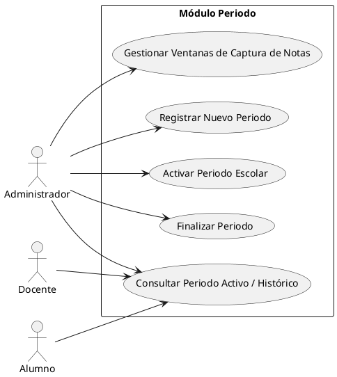

# Módulo Periodo

> **Equipo 2: Módulo de Periodo**

## Resumen

El Módulo Periodo permite administrar los periodos escolares del Sistema de Control Escolar. Facilita el registro de nuevos periodos, su activación y finalización, así como la configuración de las ventanas de captura de notas. También permite consultar el periodo escolar activo y los periodos históricos, de acuerdo con las funciones de cada usuario.

## Objetivo y Alcance

**Objetivo:** Gestionar el ciclo de vida de los periodos escolares para mantener organizada la actividad académica y controlar los tiempos destinados a la captura de calificaciones.

**Alcance:** El módulo contempla el registro de nuevos periodos escolares, su activación, finalización, configuración de ventanas de captura de notas y consulta de periodos activos e históricos. Las operaciones de administración corresponden al Administrador, mientras que el Docente y el Alumno pueden consultar la información de los periodos.

## Requerimientos funcionales

- **RF01. Registrar nuevo periodo:** El sistema debe permitir al Administrador registrar un nuevo periodo escolar.
- **RF02. Activar periodo escolar:** El sistema debe permitir al Administrador activar un periodo previamente registrado.
- **RF03. Consultar periodo activo e histórico:** El sistema debe permitir consultar el periodo escolar activo y los periodos anteriores.
- **RF04. Finalizar periodo:** El sistema debe permitir al Administrador finalizar un periodo escolar.
- **RF05. Gestionar ventanas de captura de notas:** El sistema debe permitir al Administrador configurar y gestionar los intervalos habilitados para la captura de calificaciones.
- **RF06. Restringir operaciones por actor:** El sistema debe permitir las operaciones administrativas únicamente a los usuarios autorizados, mientras que el Docente y el Alumno podrán consultar los periodos según sus permisos.

## Actores

- **Administrador:** Registra nuevos periodos, activa y finaliza periodos escolares, gestiona las ventanas de captura de notas y consulta los periodos registrados.
- **Docente:** Consulta el periodo escolar activo y los periodos históricos disponibles.
- **Alumno:** Consulta el periodo escolar activo y los periodos históricos disponibles.

## Diagrama de casos de uso

El siguiente diagrama representa las funciones y los actores del Módulo Periodo, de acuerdo con el diseño proporcionado.

### Código fuente UML

### Imagen del diagrama

Se integrará la imagen del diagrama de casos de uso generado a partir del código UML anterior.

## Glosario y Abreviaturas

| Término | Definición |
|---|---|
| Periodo escolar | Intervalo en el que se desarrollan las actividades académicas. |
| Periodo activo | Periodo escolar habilitado como vigente dentro del sistema. |
| Periodo histórico | Periodo escolar anterior que se conserva para consulta. |
| Ventana de captura de notas | Intervalo durante el cual se permite registrar o capturar calificaciones. |
| UML | Lenguaje Unificado de Modelado (*Unified Modeling Language*). |
| RF | Requerimiento funcional. |
| RNF | Requerimiento no funcional. |

## Requerimientos no funcionales

- **RNF01. Seguridad:** Las funciones administrativas deben estar disponibles únicamente para usuarios con los permisos correspondientes.
- **RNF02. Integridad de la información:** El sistema debe validar los datos de cada periodo antes de guardarlos.
- **RNF03. Consistencia temporal:** Las fechas de inicio y término de un periodo deben ser válidas y coherentes.
- **RNF04. Control de captura:** El sistema debe respetar las ventanas de captura de notas configuradas para el periodo.
- **RNF05. Usabilidad:** La interfaz debe presentar claramente el periodo activo y los periodos históricos disponibles para consulta.
- **RNF06. Disponibilidad de consulta:** La información de los periodos debe poder consultarse cuando el sistema esté disponible y el usuario cuente con los permisos necesarios.

## Referencias

- Diagrama de casos de uso del Módulo Periodo proporcionado para el proyecto.
- Especificaciones y reglas de operación del Sistema de Control Escolar.

