# Proyecto Final: Sistema Integral de Control Escolar

## Módulo 1: Alumnos (Equipo 1)

## Tabla de Contenido

1. I. Introducción y Resumen del Módulo
2. II. Contexto del Módulo
   - 2.1. Problemas que se pretenden resolver
   - 2.2. Oportunidades que se buscan aprovechar
3. III. Objetivos y Alcance
   - 3.1. Objetivo General
   - 3.2. Objetivos Específicos
   - 3.3. Límites del Módulo (Dentro del alcance)
   - 3.4. Exclusiones y Servicios Compartidos (Fuera del alcance directo)
4. IV. Requerimientos del Módulo
   - 4.1. Requerimientos Funcionales (RF)
   - 4.2. Requerimientos No Funcionales (RNF)
5. V. Actores del Módulo
6. VI. Modelado del Sistema (Diagramas UML)
   - 6.1. Diagrama de Contexto del Módulo
   - 6.2. Diagrama de Casos de Uso
   - 6.3. Diagrama de Clases
   - 6.4. Diagrama de Componentes
   - 6.5. Diagramas de Secuencia
   - 6.6. Diagramas de Actividades
   - 6.7. Diagramas de Estados
7. VII. Interfaz de Usuario (Wireframes / Mockups)
8. VIII. Autorización y Permisos del Módulo
9. IX. Glosario, Abreviaturas y Nomenclaturas
10. X. Referencias Bibliográficas

---

## I. Introducción y Resumen del Módulo

El **Módulo de Alumnos** reúne las vistas y operaciones del Sistema Integral de Control Escolar (SIGE) destinadas al estudiante para consultar su información académica, actualizar sus datos generales, dar seguimiento a su proceso de reinscripción y descargar su constancia de estudios en PDF, reutilizando los servicios y entidades comunes del sistema.

---

## II. Contexto del Módulo

### 2.1. Problemas que se pretenden resolver

- **Atención presencial lenta para consultas y constancias:** Necesidad de acudir de forma presencial para revisar el estatus de reinscripción o solicitar una constancia de estudios.
- **Acceso fragmentado a información académica:** Dificultad para consultar horarios vigentes, calificaciones, historial académico y materias inscritas desde distintos dispositivos.
- **Datos de contacto desactualizados:** Falta de un mecanismo directo para que el alumno mantenga al día sus datos generales de contacto.
- **Falta de visibilidad del trámite de reinscripción:** Desconocimiento oportuno del estado actual de la reinscripción (*En proceso*, *Aprobado*, *Rechazado* o *Con observaciones*).

### 2.2. Oportunidades que se buscan aprovechar

- **Autoservicio estudiantil:** Acceso continuo y remoto del alumno a sus consultas, actualizaciones permitidas y descargas.
- **Reutilización de componentes institucionales:** Consumo de servicios compartidos del SIGE (como gestión de sesión/identidad, generación de PDF y datos académicos) evitando duplicidad entre módulos.
- **Seguimiento claro de trámites:** Consulta directa del estado de reinscripción sin depender de gestiones presenciales innecesarias.

---

## III. Objetivos y Alcance

### 3.1. Objetivo General

Proporcionar al alumno las funcionalidades del SIGE para gestionar su perfil permitido, consultar su información académica, dar seguimiento a su reinscripción y descargar su constancia de estudios.

### 3.2. Objetivos Específicos

- Permitir el acceso a la sesión del alumno, la consulta de datos personales, la edición de datos generales y el cambio de contraseña.
- Facilitar la consulta de calificaciones, historial académico, horario y materias inscritas.
- Permitir iniciar la reinscripción y consultar su estado actual.
- Habilitar la generación y descarga de la constancia de estudios en formato PDF.

### 3.3. Límites del Módulo (Dentro del alcance)

- **Perfil y cuenta del alumno:** Flujos de acceso/sesión (`UC1`), edición de datos generales (`UC2`), consulta de datos personales (`UC4`) y cambio de contraseña (`UC10`). *(Sujeto a alineación con el módulo/servicio de identidad y acceso si el equipo lo centraliza).*
- **Consultas académicas:** Consulta de calificaciones (`UC5`), historial académico (`UC6`), horario (`UC7`) y materias inscritas (`UC8`).
- **Reinscripción:** Inicio del trámite (`UC3`) y consulta de su estado (`UC11`).
- **Constancias:** Descarga de constancia de estudios en PDF (`UC9`).

### 3.4. Exclusiones y Servicios Compartidos (Fuera del alcance directo)

- **Gestión de cuenta/autenticación centralizada:** Si el sistema cuenta con un módulo o servicio transversal de autenticación/seguridad, este módulo consume su sesión en lugar de reimplementar reglas de acceso.
- **Validación o resolución administrativa de reinscripciones:** Corresponde al módulo/proceso encargado de la revisión y dictamen de reinscripciones.
- **Administración de asignaturas, grupos, horarios o calificaciones:** Corresponde a los módulos académicos/administrativos responsables de esos registros.
- **Generación documental y pagos:** La compilación de documentos PDF y los procesos de pago se delegan a los servicios o módulos correspondientes del SIGE.

---

## IV. Requerimientos del Módulo

### 4.1. Requerimientos Funcionales (RF)

- **RF-01 (Iniciar sesión):** Permitir al alumno iniciar sesión en el sistema mediante sus credenciales.
- **RF-02 (Editar datos generales):** Permitir al alumno actualizar sus datos generales autorizados.
- **RF-03 (Iniciar reinscripción):** Permitir al alumno iniciar su trámite de reinscripción cuando cumpla las condiciones establecidas.
- **RF-04 (Consultar datos personales):** Permitir al alumno visualizar sus datos personales registrados.
- **RF-05 (Consultar calificaciones):** Mostrar al alumno las calificaciones correspondientes a su periodo/ciclo.
- **RF-06 (Consultar historial académico):** Mostrar al alumno su historial académico.
- **RF-07 (Consultar horario):** Mostrar al alumno su horario asignado.
- **RF-08 (Consultar materias inscritas):** Mostrar al alumno las materias inscritas.
- **RF-09 (Descargar constancia de estudios):** Permitir al alumno generar y descargar su constancia de estudios en PDF cuando cumpla las condiciones de vigencia.
- **RF-10 (Cambiar contraseña):** Permitir al alumno cambiar su contraseña previa validación de la contraseña actual.
- **RF-11 (Consultar estado de reinscripción):** Permitir al alumno consultar el estado actual de su trámite de reinscripción.

### 4.2. Requerimientos No Funcionales (RNF)

- **RNF-01 (Seguridad de credenciales):** Las contraseñas deben almacenarse cifradas mediante hash criptográfico seguro.
- **RNF-02 (Expiración de sesión):** Las sesiones inactivas deben expirar automáticamente tras 15 minutos.
- **RNF-03 (Tiempo de respuesta en consultas):** Las consultas del módulo deben responder en menos de 5 segundos en operación normal.
- **RNF-04 (Tiempo de generación de PDF):** La descarga de la constancia de estudios en PDF debe completarse en un máximo de 3 segundos.
- **RNF-05 (Disponibilidad):** El módulo debe mantenerse disponible al menos el 99% del tiempo en periodos de alta demanda como reinscripciones.
- **RNF-06 (Responsividad):** La interfaz debe adaptarse a pantallas de escritorio, tableta y teléfono móvil.

---

## V. Actores del Módulo

| Actor | Tipo | Definición |
| :--- | :--- | :--- |
| **Alumno** | Primario | Estudiante registrado en la institución con matrícula asignada y vínculo académico dentro del SIGE. |
| **Servicio de Documentos PDF** | Secundario (Sistema) | Servicio del sistema que genera el archivo PDF de la constancia de estudios con los datos y folio correspondientes. |
| **Repositorio de Datos del SIGE** | Secundario (Sistema) | Almacén de datos compartido del sistema donde se consultan y actualizan los registros asociados al alumno. |

---

## VI. Modelado del Sistema (Diagramas UML)

Los archivos fuente PlantUML se almacenan en `uml/` y se referencian junto a cada diagrama.

### 6.1. Diagrama de Casos de Uso

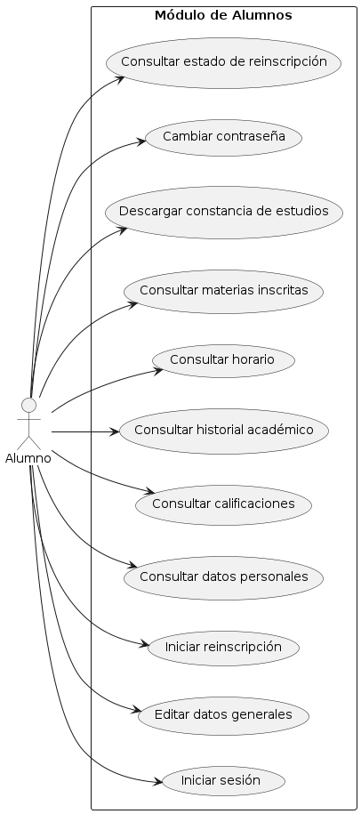

- Fuente UML: `uml/Casos_de_uso.uml`

### 6.2. Diagrama de Clases

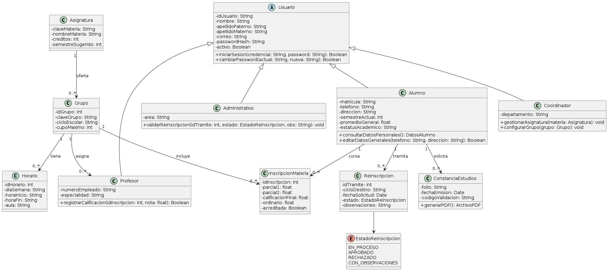

- Fuente UML: `uml/DIAGRAMA_DE_CLASES.uml`

### 6.3. Diagramas de Secuencia

#### UC1: Iniciar sesión
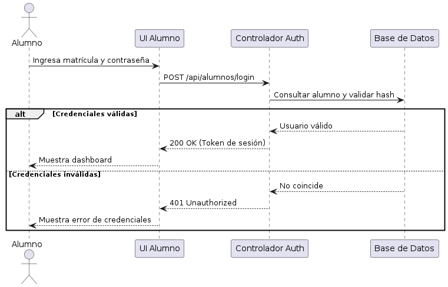
- Fuente UML: `uml/D_A_Inicio.uml`

#### UC2: Editar datos generales
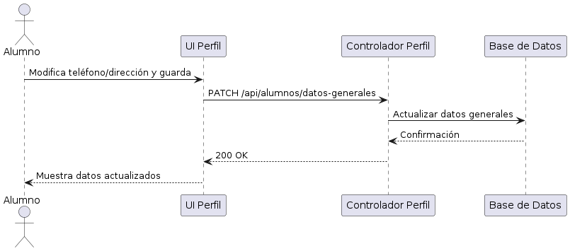
- Fuente UML: `uml/D_A_Editar.uml`

#### UC3: Iniciar reinscripción
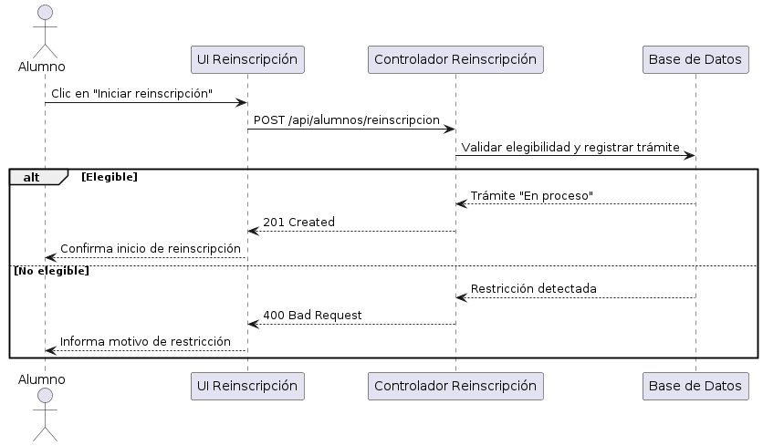
- Fuente UML: `uml/D_A_Rincripcion.uml`

#### UC4: Consultar datos personales
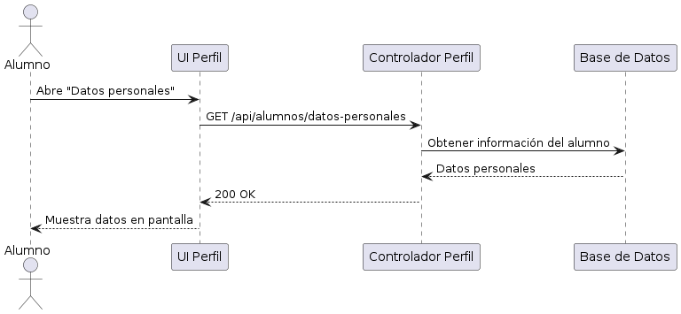
- Fuente UML: `uml/D_A_Consultar.uml`

#### UC5: Consultar calificaciones
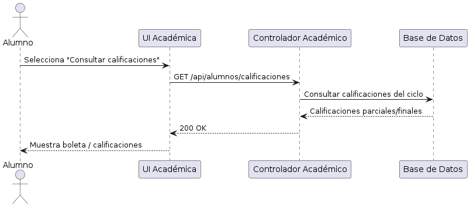
- Fuente UML: `uml/calificaciones.uml`

#### UC6: Consultar historial académico
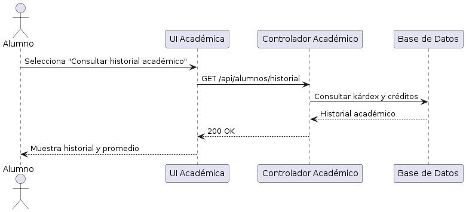
- Fuente UML: `uml/historial.uml`

#### UC7: Consultar horario
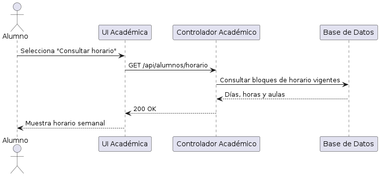
- Fuente UML: `uml/horario.uml`

#### UC8: Consultar materias inscritas

- Fuente UML: `uml/materias.uml`

#### UC9: Descargar constancia de estudios
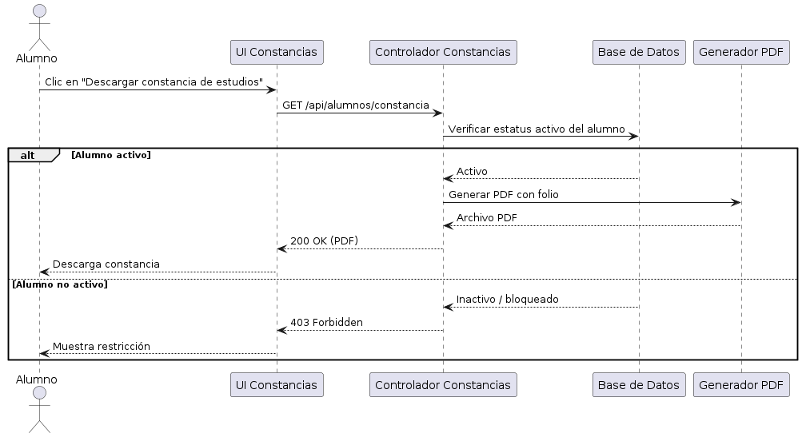
- Fuente UML: `uml/constancia.uml`

#### UC10: Cambiar contraseña
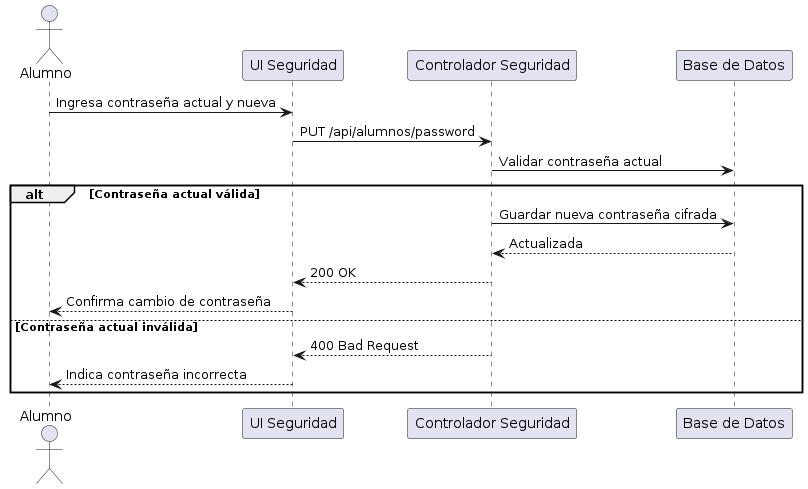
- Fuente UML: `uml/contraseña.uml`

#### UC11: Consultar estado de reinscripción

- Fuente UML: `uml/estado.uml`

### 6.6. Diagramas de Actividades

#### UC1: Iniciar sesión
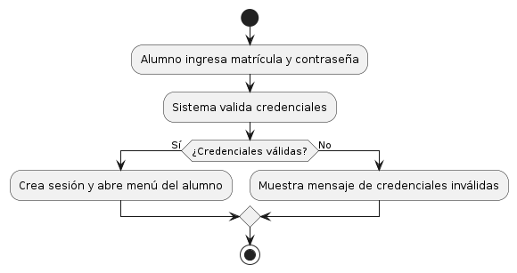
- Fuente UML: `uml/UC01.uml`

#### UC2: Editar datos generales
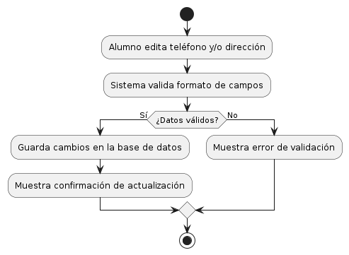
- Fuente UML: `uml/UC02.uml`

#### UC3: Iniciar reinscripción

- Fuente UML: `uml/UC03.uml`

#### UC4: Consultar datos personales

- Fuente UML: `uml/UC04.uml`

#### UC5: Consultar calificaciones
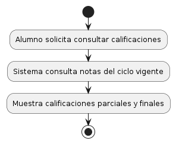
- Fuente UML: `uml/UC05.uml`

#### UC6: Consultar historial académico
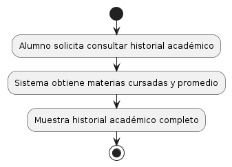
- Fuente UML: `uml/UC06.uml`

#### UC7: Consultar horario
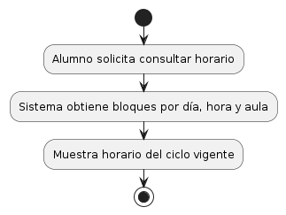
- Fuente UML: `uml/UC07.uml`

#### UC8: Consultar materias inscritas
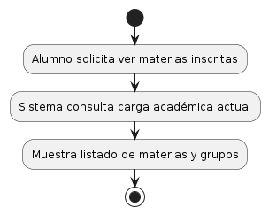
- Fuente UML: `uml/UC08.uml`

#### UC9: Descargar constancia de estudios
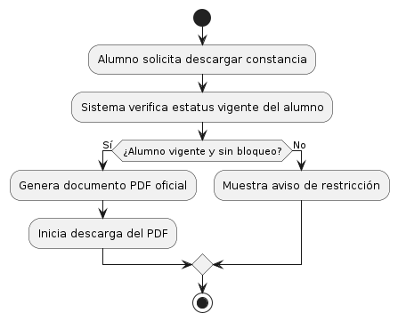
- Fuente UML: `uml/UC09.uml`

#### UC10: Cambiar contraseña
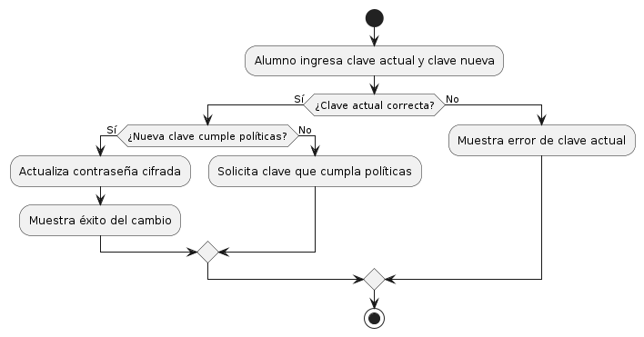
- Fuente UML: `uml/UC10.uml`

#### UC11: Consultar estado de reinscripción
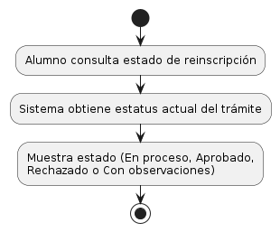
- Fuente UML: `uml/UC11.uml`

### 6.7. Diagramas de Estados

#### Trámite de Reinscripción (UC11)
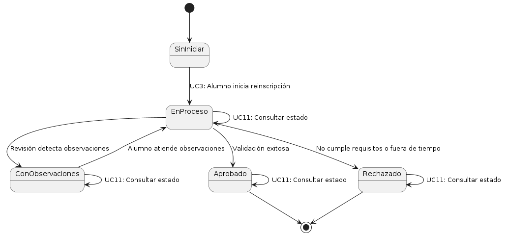
- Fuente UML: `uml/Diagrama_de_estados.uml`

#### Sesión del Alumno
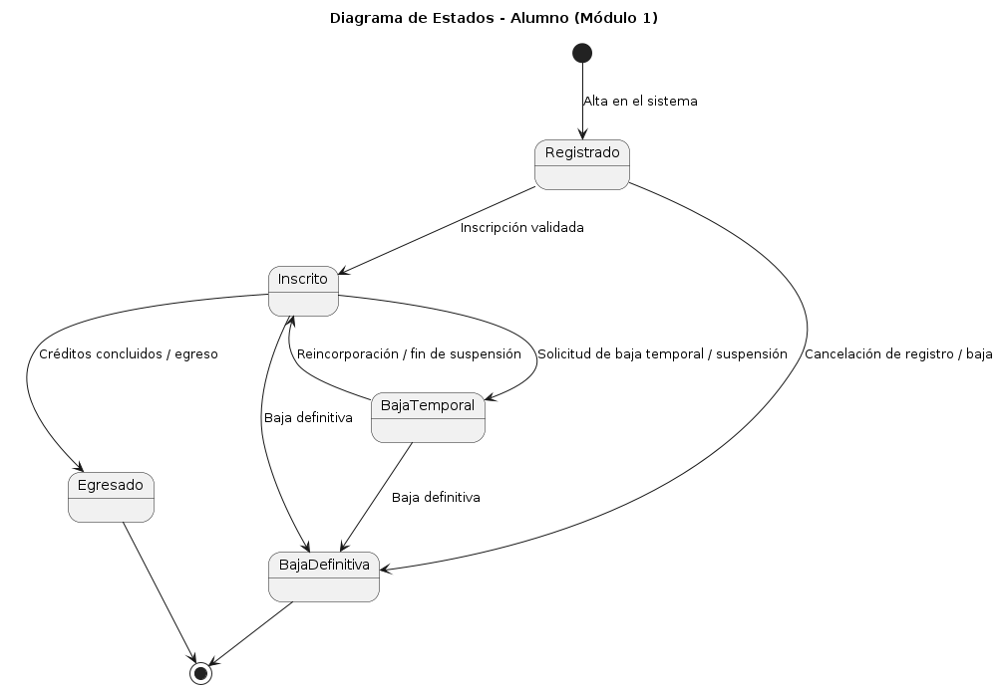
- Fuente UML: `uml/segundodiagrama.uml`

---

## VII. Interfaz de Usuario (Wireframes / Mockups)

1. **Acceso / Sesión:** Formulario de ingreso y opción de cambio de contraseña.
2. **Panel principal:** Acceso a perfil, consultas académicas, reinscripción y constancias, junto con un resumen del estado del alumno.
3. **Consultas académicas:** Vistas para horario, calificaciones, historial académico y materias inscritas.
4. **Reinscripción y constancia:** Acciones para iniciar o consultar el estado de reinscripción y descargar la constancia en PDF.

---

## VIII. Autorización y Permisos del Módulo

El acceso a las operaciones del módulo se valida sobre la identidad y pertenencia del **Alumno** autenticado, con expiración de sesión tras 15 minutos de inactividad.

| Operación / Recurso del Módulo | Permiso del Actor Alumno | Alcance de Datos |
| :--- | :---: | :--- |
| **Iniciar sesión / Cambiar contraseña** | Permitido | Cuenta propia |
| **Consultar / Editar datos generales** | Lectura y escritura | Registros propios |
| **Consultar calificaciones, historial, horario y materias** | Solo lectura | Registros propios |
| **Iniciar / Consultar estado de reinscripción** | Permitido / Solo lectura | Trámite propio |
| **Descargar constancia de estudios (PDF)** | Permitido | Constancia propia |

---

## IX. Glosario, Abreviaturas y Nomenclaturas

### Abreviaturas

- **API:** *Application Programming Interface*.
- **PDF:** *Portable Document Format*.
- **RF:** Requerimiento Funcional.
- **RNF:** Requerimiento No Funcional.
- **SIGE:** Sistema Integral de Gestión Escolar.
- **UC:** *Use Case* (Caso de Uso).
- **UI:** *User Interface*.
- **UML:** *Unified Modeling Language*.

### Nomenclaturas

- **Requerimientos Funcionales:** `RF-XX` (ej. `RF-09`).
- **Requerimientos No Funcionales:** `RNF-XX` (ej. `RNF-03`).
- **Casos de Uso:** `UCX` (ej. `UC1` a `UC11`).
- **Imágenes del módulo:** `resources/imgs/[Nombre_Archivo].png`.
- **Fuentes UML del módulo:** `uml/[nombre].uml`.

---

## X. Referencias Bibliográficas

- Booch, G., Rumbaugh, J., & Jacobson, I. (2006). *El Lenguaje Unificado de Modelado: Guía del Usuario* (2.ª ed.). Addison-Wesley.
- Pressman, R. S., & Maxim, B. R. (2021). *Ingeniería del Software: Un enfoque práctico* (9.ª ed.). McGraw-Hill Education.
- Sommerville, I. (2011). *Ingeniería de Software* (9.ª ed.). Pearson Educación.
- Object Management Group (OMG). (2017). *OMG Unified Modeling Language (OMG UML), Version 2.5.1*. https://www.omg.org/spec/UML/
- PlantUML Documentation. (2025). *PlantUML Language Reference Guide*. https://plantuml.com/
=======
# Módulo Alumnos

> Equipo 1: Alumnos

# Resumen

El Módulo de Alumnos comprende la interfaz y lógica del sistema orientada al uso directo por parte del estudiante.

Centraliza las herramientas académicas y administrativas que permiten al alumno consultar su rendimiento escolar, gestionar su información personal, realizar trámites de inscripción y reinscripción, y solicitar documentos oficiales sin acudir presencialmente a las oficinas administrativas.

# Objetivo y Alcance

## Objetivo general

Proporcionar a los alumnos un acceso unificado, intuitivo y seguro para gestionar su perfil, consultar su información académica y realizar trámites administrativos institucionales.

## Objetivos específicos

- Permitir la autenticación y actualización de datos personales y de contacto.
- Facilitar la consulta de calificaciones, horarios, materias inscritas e historial académico.
- Generar y permitir la descarga de documentos oficiales, como la constancia de estudios.
- Agilizar los procesos de reinscripción.

## Alcance

**Dentro del alcance:**

- Inicio de sesión y gestión del perfil (contraseña, datos personales, domicilio y contacto).
- Consultas académicas (calificaciones, historial, horario y materias inscritas).
- Trámites de reinscripción y consulta de su estado.
- Descarga de constancias de estudios en PDF.

**Fuera del alcance:**

- Captura de calificaciones (correspondiente al Módulo de Profesores).

# Requerimientos funcionales

- **RF-07 (Consultar horario):** El alumno podrá visualizar sus clases por día y hora del ciclo vigente.
- **RF-08 (Consultar materias inscritas):** El alumno podrá consultar las materias de su carga académica actual.
- **RF-09 (Descargar constancia):** El sistema generará una constancia oficial de estudios en PDF para su descarga.
- **RF-10 (Cambiar contraseña):** El alumno podrá cambiar su contraseña validando primero la actual.
- **RF-11 (Consultar reinscripción):** El alumno podrá consultar el estado de su reinscripción: en proceso, aprobado, rechazado o con observaciones.

# Actores

| Actor | Descripción y funciones |
|---|---|
| Alumno | Usuario del sistema que puede iniciar sesión, gestionar sus datos personales, consultar información académica, realizar trámites de reinscripción y descargar constancias de estudios. |

# Diagrama de casos de uso

**Código fuente UML:**

```@startuml
left to right direction

actor "Alumno" as A

rectangle "Módulo de Alumnos" {
    usecase "Iniciar sesión" as UC1
    usecase "Editar datos generales" as UC2
    usecase "Iniciar reinscripción" as UC3
    usecase "Consultar datos personales" as UC4
    usecase "Consultar calificaciones" as UC5
    usecase "Consultar historial académico" as UC6
    usecase "Consultar horario" as UC7
    usecase "Consultar materias inscritas" as UC8
    usecase "Descargar constancia de estudios" as UC9
    usecase "Cambiar contraseña" as UC10
    usecase "Consultar estado de reinscripción" as UC11
}

A --> UC1
A --> UC2
A --> UC3
A --> UC4
A --> UC5
A --> UC6
A --> UC7
A --> UC8
A --> UC9
A --> UC10
A --> UC11

@enduml

```

**Imagen del diagrama:**

[Diagrama de casos de uso - Módulo Alumnos](resources/imgs/m1_alumnos_casos_de_uso.png)

# Diagrama de componentes

**Nota:** Generar un diagrama de componentes por cada caso de uso.

**Código fuente UML:**

<!-- Agregar aqui el enlace al archivo del codigo fuente UML -->

**Imagen de los diagramas:**

<!-- Agregar aqui las imagenes de los diagramas de componentes -->

# Diagrama de secuencia

**Nota:** Generar un diagrama de secuencia por cada caso de uso.

**Código fuente UML:**

<!-- Agregar aqui el enlace al archivo del codigo fuente UML -->

**Imagen de los diagramas:**

<!-- Agregar aqui las imagenes de los diagramas de secuencia -->

# Diagrama de estados


**Código fuente UML:**

<!-- Agregar aqui el enlace al archivo del codigo fuente UML -->

**Imagen del diagrama:**

<!-- Agregar aquí la imagen del diagrama de estados. -->

# Diagrama de clases

**Código fuente UML:**

<!-- Agregar aquí el enlace al archivo del código fuente UML. -->

**Imagen del diagrama:**

<!-- Agregar aquí la imagen del diagrama de clases. -->

# Glosario y Abreviaturas

- **RF:** Requerimiento Funcional.
- **RNF:** Requerimiento No Funcional.
- **UC:** Caso de Uso.
- **UI:** Interfaz de Usuario.
- **PDF:** Formato de Documento Portable.

# Requerimientos No Funcionales

- **RNF-01 (Autenticación):** El sistema debe requerir credenciales válidas para acceder al módulo.
- **RNF-02 (Cifrado de contraseñas):** Las contraseñas almacenadas deben protegerse mediante algoritmos de cifrado seguros.
- **RNF-03 (Sesiones expiradas):** La sesión del alumno se cerrará automáticamente después de 15 minutos de inactividad.
- **RNF-04 (Tiempo de respuesta):** Las consultas deben responder en menos de 5 segundos en condiciones normales.
- **RNF-05 (Generación de PDF):** La descarga de constancias no debe tardar más de 3 segundos.
- **RNF-06 (Disponibilidad):** El módulo debe mantener una disponibilidad mínima del 99% durante los periodos críticos de reinscripción.
- **RNF-07 (Diseño responsivo):** La interfaz debe adaptarse a celulares, tabletas y computadoras.
- **RNF-08 (Accesibilidad):** Los elementos visuales deben tener contraste adecuado y una navegación clara.
