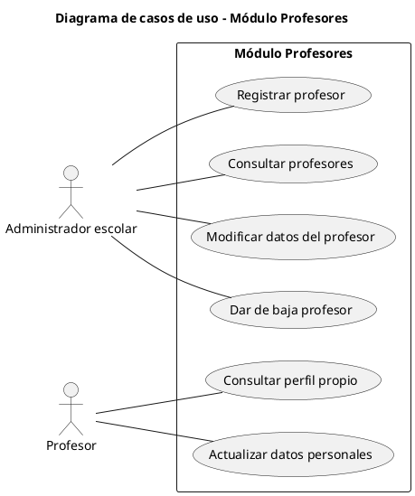
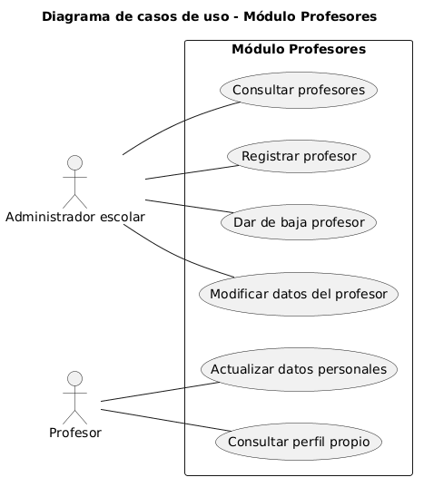

# Módulo 3: Profesores

## Equipo 3

## 1. Resumen

El Módulo de Profesores se encarga de gestionar la información de los docentes de la institución dentro del sistema. Permite al administrador escolar registrar, consultar, modificar y dar de baja profesores, y permite a cada profesor consultar su propio perfil y mantener actualizados sus datos personales.

Este módulo funciona como fuente de información de los docentes para el resto del sistema (por ejemplo, para asignarlos a grupos o materias). (*)

## 2. Objetivo y Alcance

### Objetivo
Centralizar y mantener actualizado el registro de profesores de la institución, garantizando que su información sea consistente, accesible para quien corresponda y protegida frente a modificaciones no autorizadas.

### Alcance

**Incluye:**
- Alta, consulta, modificación y baja (lógica) de profesores por parte del administrador escolar.
- Consulta del perfil propio por parte del profesor.
- Actualización de datos personales y de contacto por parte del profesor.

**No incluye:**
- Asignación de profesores a grupos, materias u horarios (corresponde a otros módulos). (*)
- Captura de calificaciones o asistencia.
- Gestión de nómina o contratación.
- Autenticación y gestión de cuentas de usuario (se asume resuelta por otro módulo). (*)

## 3. Requerimientos funcionales

| ID | Requerimiento | Actor |
|---|---|---|
| RF-01 | El sistema debe permitir registrar un nuevo profesor capturando sus datos básicos (nombre, apellidos, correo, teléfono, especialidad). (*) | Administrador escolar |
| RF-02 | El sistema debe validar que no se registren profesores duplicados (por correo o identificador). (*) | Administrador escolar |
| RF-03 | El sistema debe permitir consultar el listado de profesores, con búsqueda por nombre o identificador. | Administrador escolar |
| RF-04 | El sistema debe permitir modificar los datos de un profesor registrado. | Administrador escolar |
| RF-05 | El sistema debe permitir dar de baja a un profesor, conservando su historial en el sistema. | Administrador escolar |
| RF-06 | El sistema debe permitir al profesor consultar su perfil propio. | Profesor |
| RF-07 | El sistema debe permitir al profesor actualizar sus datos personales y de contacto. | Profesor |
| RF-08 | El sistema debe mostrar un mensaje de confirmación o error tras cada operación de registro, modificación o baja. | Ambos |

## 4. Actores

| Actor | Descripción | Acciones principales |
|---|---|---|
| Administrador escolar | Personal administrativo responsable de gestionar la plantilla docente en el sistema. | Registrar profesor, consultar profesores, modificar datos del profesor, dar de baja profesor. |
| Profesor | Docente de la institución registrado en el sistema. | Consultar perfil propio, actualizar datos personales. |

## 5. Diagrama de casos de uso

### Código fuente UML

### Imagen

### Descripción de casos de uso

| ID | Caso de uso | Actor | Descripción |
|---|---|---|---|
| UC1 | Registrar profesor | Administrador escolar | Da de alta a un nuevo profesor con sus datos básicos. |
| UC2 | Consultar profesores | Administrador escolar | Muestra el listado de profesores y permite buscar y ver el detalle de uno. |
| UC3 | Modificar datos del profesor | Administrador escolar | Edita la información de un profesor ya registrado. |
| UC4 | Dar de baja profesor | Administrador escolar | Desactiva a un profesor sin borrar su historial. |
| UC5 | Consultar perfil propio | Profesor | Permite al profesor ver su información registrada. |
| UC6 | Actualizar datos personales | Profesor | Permite al profesor modificar sus datos personales y de contacto. |

## 6. Glosario y Abreviaturas

| Término | Definición |
|---|---|
| Profesor | Docente de la institución registrado en el sistema. |
| Administrador escolar | Usuario con permisos para gestionar la información de los profesores. |
| Alta | Registro de un nuevo profesor en el sistema. |
| Baja | Desactivación de un profesor; sus datos se conservan como historial. |
| Perfil | Conjunto de datos personales y de contacto de un profesor. |
| Caso de uso | Descripción de una interacción entre un actor y el sistema para lograr un objetivo. |
| RF | Requerimiento funcional. |
| RNF | Requerimiento no funcional. |
| UC | Use case (caso de uso). |
| UML | Unified Modeling Language (Lenguaje Unificado de Modelado). |

## 7. Requerimientos No funcionales

| ID | Categoría | Requerimiento |
|---|---|---|
| RNF-01 | Seguridad | Solo el administrador escolar puede registrar, modificar o dar de baja profesores. |
| RNF-02 | Seguridad | Un profesor solo puede consultar y modificar su propio perfil, nunca el de otros. |
| RNF-03 | Usabilidad | Las operaciones principales deben poder realizarse en pocos pasos, con mensajes claros de error y confirmación. |
| RNF-04 | Rendimiento | La consulta del listado de profesores debe responder en menos de 3 segundos. (*) |
| RNF-05 | Integridad | Los datos de profesores dados de baja deben conservarse; no se eliminan físicamente. |
| RNF-06 | Privacidad | Los datos personales de los profesores deben tratarse de forma confidencial. |
| RNF-07 | Disponibilidad | El módulo debe estar disponible durante el horario de operación de la institución. (*) |