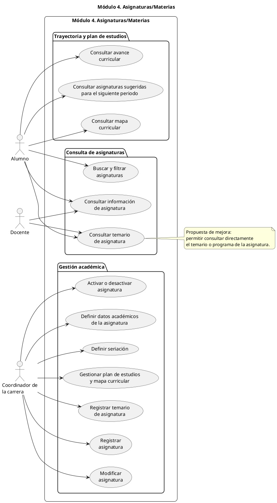
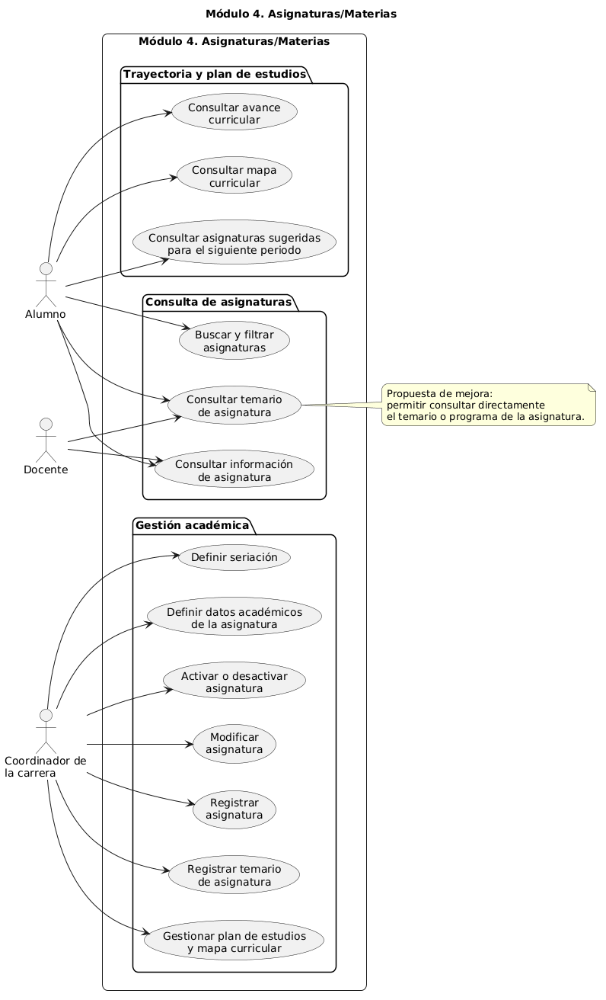

# Módulo 4: Asignaturas/Materias

> Equipo 4

## Resumen

El módulo de Asignaturas/Materias permite consultar y administrar la información académica de las unidades de aprendizaje de un programa educativo, incluyendo el mapa curricular, el avance curricular, las asignaturas sugeridas para el siguiente periodo y la información de cada asignatura.

## Objetivo y Alcance

El objetivo del módulo es facilitar la consulta y administración de la información académica de las asignaturas y su relación con el plan de estudios.

El módulo contempla:

- Consulta del mapa curricular.
- Consulta del avance curricular.
- Consulta de asignaturas sugeridas para el siguiente periodo.
- Consulta de información de las asignaturas.
- Búsqueda y filtrado de asignaturas.
- Consulta del temario o programa de una asignatura.
- Registro y modificación de asignaturas.
- Activación o desactivación de asignaturas.
- Definición de datos académicos y seriación.
- Gestión del plan de estudios y mapa curricular.
- Registro del temario o programa de una asignatura.

## Requerimientos funcionales

- **RF01.** El sistema deberá permitir al alumno consultar el mapa curricular de su programa educativo.
- **RF02.** El sistema deberá permitir al alumno consultar su avance curricular mediante el estado de sus asignaturas.
- **RF03.** El sistema deberá mostrar al alumno las asignaturas sugeridas para el siguiente periodo.
- **RF04.** El sistema deberá permitir consultar la información académica de una asignatura.
- **RF05.** El sistema deberá permitir buscar y filtrar asignaturas utilizando criterios disponibles, como nombre, periodo, núcleo o carácter.
- **RF06.** El sistema deberá permitir al alumno y al docente consultar el temario o programa de una asignatura.
- **RF07.** El sistema deberá permitir al coordinador de la carrera registrar una asignatura.
- **RF08.** El sistema deberá permitir al coordinador de la carrera modificar la información de una asignatura.
- **RF09.** El sistema deberá permitir al coordinador de la carrera activar o desactivar una asignatura sin eliminar su información histórica.
- **RF10.** El sistema deberá permitir al coordinador definir los datos académicos de una asignatura, como créditos, carácter, núcleo y periodo.
- **RF11.** El sistema deberá permitir al coordinador definir la seriación de las asignaturas.
- **RF12.** El sistema deberá permitir al coordinador gestionar la organización de las asignaturas dentro del plan de estudios y mapa curricular.
- **RF13.** El sistema deberá permitir al coordinador registrar el archivo o enlace institucional correspondiente al temario de una asignatura.

## Actores

### Alumno

Usuario inscrito en un programa educativo que consulta la información relacionada con las asignaturas de su plan de estudios.

**Características:**
- Tiene acceso principalmente de consulta.
- Puede visualizar el mapa y avance curricular.
- Puede consultar asignaturas sugeridas para el siguiente periodo.
- Puede consultar, buscar y filtrar asignaturas.
- Puede consultar la información académica y el temario de una asignatura.
- No puede modificar el catálogo ni el plan de estudios.

### Coordinador de la carrera

Usuario responsable de supervisar y mantener la estructura académica del programa educativo de su carrera.

**Características:**
- Puede registrar y modificar asignaturas.
- Puede activar o desactivar asignaturas.
- Puede definir datos académicos y seriación.
- Puede organizar las asignaturas dentro del plan de estudios y mapa curricular.
- Puede registrar el temario o enlace institucional de una asignatura.

### Docente

Usuario académico encargado de impartir una o más asignaturas.

**Características:**
- Tiene acceso de consulta dentro de este módulo.
- Puede consultar la información académica de una asignatura.
- Puede consultar el temario o programa de una asignatura.
- La captura de calificaciones no forma parte de este módulo.

## Diagrama de casos de uso

## Glosario y Abreviaturas

- **Asignatura/Materia (U.A.):** unidad de aprendizaje que forma parte del plan de estudios de un programa educativo.
- **Mapa curricular:** representación de las asignaturas que integran un plan de estudios y su organización por periodos.
- **Plan de estudios:** estructura académica que define las asignaturas que debe cursar un alumno dentro de una carrera.
- **Seriación:** relación académica que establece una secuencia u orden entre determinadas asignaturas.
- **Carácter:** clasificación de una asignatura, por ejemplo obligatoria u optativa.
- **Núcleo:** área de formación a la que pertenece una asignatura.
- **Avance curricular:** progreso del alumno dentro de su plan de estudios de acuerdo con las asignaturas acreditadas, inscritas o pendientes.

## Requerimientos No funcionales

- **RNF01 - Usabilidad.** La información de las asignaturas y del mapa curricular deberá presentarse de forma clara y comprensible para los usuarios.
- **RNF02 - Rendimiento.** Las consultas, búsquedas y filtros de asignaturas deberán responder en un tiempo adecuado bajo condiciones normales de uso.
- **RNF03 - Seguridad.** El sistema deberá restringir las funciones de modificación del catálogo y del plan de estudios a usuarios autorizados.
- **RNF04 - Integridad.** El sistema deberá conservar la consistencia de la información académica al modificar asignaturas, seriaciones o el plan de estudios.
- **RNF05 - Disponibilidad.** La información de las asignaturas deberá estar disponible para consulta durante los periodos en que los usuarios requieran acceder al sistema.
- **RNF06 - Mantenibilidad.** La estructura del módulo deberá permitir actualizar asignaturas, planes de estudio y temarios sin afectar innecesariamente otros módulos.
