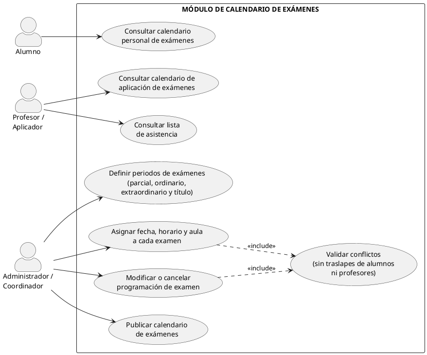
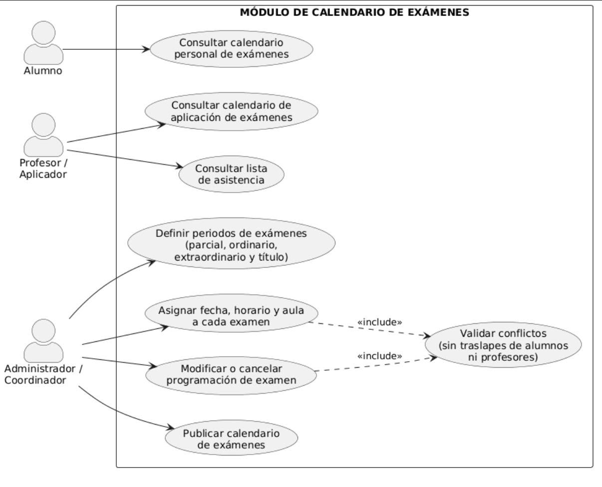
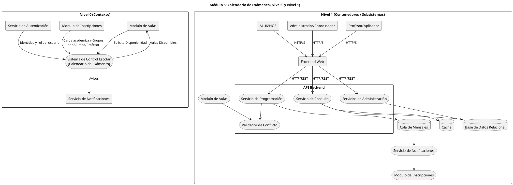
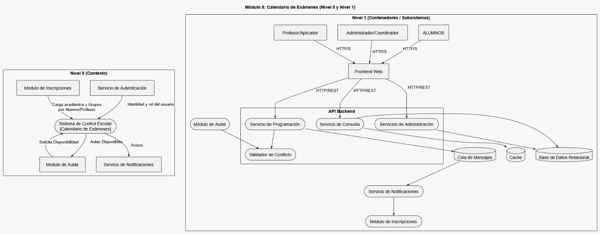

# Módulo Calendario de Exámenes

>
> Equipo 5
> (Jorge Uriel Vidal Morales, Melany Joana Toledo Escamilla, Alan Daniel Salas Gutierrez, Samuel Riveroll Vargas)
>

## Resumen
El **Módulo de Calendario de Exámenes** es la base para la planificación, organización y publicación de las evaluaciones académicas dentro del sistema de control escolar universitario. Su objetivo principal es automatizar y gestionar la programación de los diferentes tipos de evaluaciones (parciales, ordinarios, extraordinarios y título de suficiencia), garantizando la disponibilidad de aulas, evitando el traslape de horarios para alumnos y docentes, y facilitando la consulta centralizada en tiempo real.

## Objetivo y Alcance
### Objetivo
Automatizar y gestionar la planificación, organización y publicación de las evaluaciones académicas, asegurando la disponibilidad de espacios y evitando cruces de horarios para la comunidad estudiantil y docente.

### Alcance
Comprende la definición de periodos de evaluación, asignación de fechas, horarios y aulas, detección automática de conflictos por traslapes, publicación de calendarios y consultas personalizadas para alumnos, profesores y administradores.

## Requerimientos funcionales

**RF-01. Programación de periodos de exámenes**

El sistema deberá permitir al Administrador / Coordinador definir y configurar las ventanas de fechas habilitadas para la aplicación de exámenes parciales, ordinarios, extraordinarios y a título de suficiencia, de acuerdo con el calendario escolar vigente.

**RF-02. Asignación de fechas, horarios y aulas**

El sistema deberá permitir al Administrador / Coordinador programar exámenes mediante la selección de asignatura, fecha, hora de inicio, hora de finalización, aula física o virtual y profesor o aplicador responsable.

**RF-03. Validación automática de conflictos**

El sistema deberá verificar, antes de registrar o modificar una programación, que no existan traslapes de horario para los alumnos y profesores involucrados. También deberá validar la disponibilidad del aula mediante la información proporcionada por el Módulo de Aulas. Si existe algún conflicto, el sistema deberá impedir la asignación e informar el motivo.

**RF-04. Consulta personalizada del calendario del alumno**

El sistema deberá permitir al Alumno consultar su calendario personal de exámenes, mostrando únicamente las evaluaciones correspondientes a las asignaturas en las que se encuentre inscrito, con sus respectivas fechas, horarios y aulas.

**RF-05. Consulta del calendario del profesor o aplicador**

El sistema deberá permitir al Profesor / Aplicador consultar los exámenes que tenga asignados, incluyendo asignatura, grupo, fecha, horario y aula correspondiente.

**RF-06. Modificación y cancelación de exámenes programados**

El sistema deberá permitir al Administrador / Coordinador modificar o cancelar una programación existente. Cuando se modifique la fecha, horario o aula, deberán ejecutarse nuevamente las validaciones de disponibilidad y conflictos antes de guardar los cambios.

**RF-07. Publicación del calendario de exámenes**

El sistema deberá permitir al Administrador / Coordinador publicar los calendarios de exámenes previamente programados y validados, para que los alumnos y profesores autorizados puedan consultarlos.

**RF-08. Consulta de listas de asistencia**

El sistema deberá permitir al Profesor / Aplicador consultar la lista de alumnos inscritos y habilitados para presentar cada examen asignado, identificando el grupo, asignatura y evaluación correspondiente.

## Actores

| Actor | Descripción | Funciones principales | Casos de uso |
|---|---|---|---|
| Administrador / Coordinador | Personal autorizado para administrar la programación de evaluaciones académicas. | Definir periodos de exámenes, asignar fechas, horarios y aulas, modificar o cancelar programaciones y publicar calendarios. | UC1, UC2, UC4, UC5 |
| Alumno | Estudiante inscrito en asignaturas que requieren evaluaciones académicas. | Consultar su calendario personal de exámenes, incluyendo fecha, horario, aula y asignatura. | UC6 |
| Profesor / Aplicador | Personal docente responsable de aplicar evaluaciones académicas. | Consultar el calendario de exámenes asignados y las listas de asistencia correspondientes. | UC7, UC8 |

## Diagrama de casos de uso

## Descripción
- **UC1: Definir periodos de exámenes:** Permite al Administrador/Coordinador establecer las ventanas de fechas hábiles para las distintas evaluaciones académicas (parciales, ordinarios, extraordinarios y título de suficiencia).
  
- **UC2: Asignar fecha, horario y aula a cada examen:** Permite fijar los parámetros espacio-temporales para la aplicación de cada evaluación dentro del calendario lectivo.
  
- **UC3: Validar conflictos (sin traslapes) `<<include>>`:** Proceso automatizado ejecutado durante la asignación o modificación para garantizar que ningún alumno o docente tenga evaluaciones empalmadas en el mismo bloque de tiempo.
  
- **UC4: Modificar o cancelar programación de examen:** Permite ajustar parámetros o suspender evaluaciones previamente registradas actualizando el estado de la agenda.
  
- **UC5: Publicar calendario de exámenes:** Hace oficial la programación para que quede disponible para consulta pública dentro del sistema.
  
- **UC6: Consultar calendario personal de exámenes:** Permite al Alumno visualizar las fechas, horarios y aulas asignadas únicamente para las asignaturas en las que se encuentra inscrito.
  
- **UC7: Consultar calendario de aplicación de exámenes:** Muestra al Profesor/Aplicador el cronograma de los exámenes donde participará como responsable o aplicador.
  
- **UC8: Consultar lista de asistencia:** Permite al Profesor/Aplicador obtener la relación oficial de alumnos habilitados para presentar la evaluación en el aula correspondiente.

## Glosario y Abreviaturas
| Abreviatura / Término | Definición |
| :--- | :--- |
| **EX-PAR** | Examen Parcial: Evaluación periódica durante el semestre. |
| **EX-ORD** | Examen Ordinario: Evaluación final del curso regular. |
| **EX-EXT** | Examen Extraordinario: Evaluación de regularización para alumnos no acreditados. |
| **EX-TS** | Examen a Título de Suficiencia: Evaluación integral extraordinaria. |

## Requerimientos No funcionales
1. **RNF-01 Concurrencia:** Soportar la alta demanda de consultas por parte de los estudiantes al momento de la publicación del calendario.
##  Diagramas de Contexto (Nivel 0 y Nivel 1)

## Descripción
### Diagrama de Nivel 0 (Contexto)

- **Módulo de Aulas:** Mantiene una comunicación bidireccional solicitando disponibilidad de espacios y devolviendo el catálogo de aulas activas e instaladas.
  
- **Módulo de Inscripciones:** Provee la carga académica de asignaturas y la lista de grupos asociados tanto a alumnos como a docentes.
  
- **Servicio de Autenticación:** Transmite la validación de identidad y el rol activo del usuario para determinar los permisos de operación dentro del sistema.
  
- **Sistema de Control Escolar (Calendario de Exámenes):** Procesa los datos recibidos para programar las evaluaciones y coordinar los recursos.
  
- **Servicio de Notificaciones:** Recibe la emisión de avisos y alertas del calendario para distribuirlos a los usuarios involucrados.
  

### Diagrama de Nivel 1 (Contenedores / Subsistemas)

- **Actores (Profesor/Aplicador, Administrador/Coordinador, ALUMNOS):** Interfazan con el sistema mediante peticiones seguras (`HTTP/S`) hacia la capa cliente.
  
- **Frontend Web:** Captura las interacciones de los usuarios y distribuye las peticiones mediante llamadas `HTTP/REST` hacia los servicios backend.
  
- **Servicios de Administración:** Gestionan la persistencia de configuraciones, modificaciones de periodos y parámetros.
  
  
- **Servicio de Programación:** Registra los eventos de examen, coordina la validación de espacios y publica eventos hacia la Cola de Mensajes.
  
- **Validador de Conflicto:** Proceso automatizado que interactúa con el Módulo de Aulas para asegurar la disponibilidad sin cruce de horarios.
  
- **Cola de Mensajes & Notificaciones:** Asincroniza la entrega de eventos hacia el Servicio de Notificaciones.
