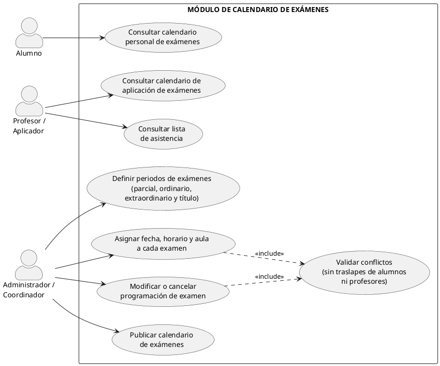
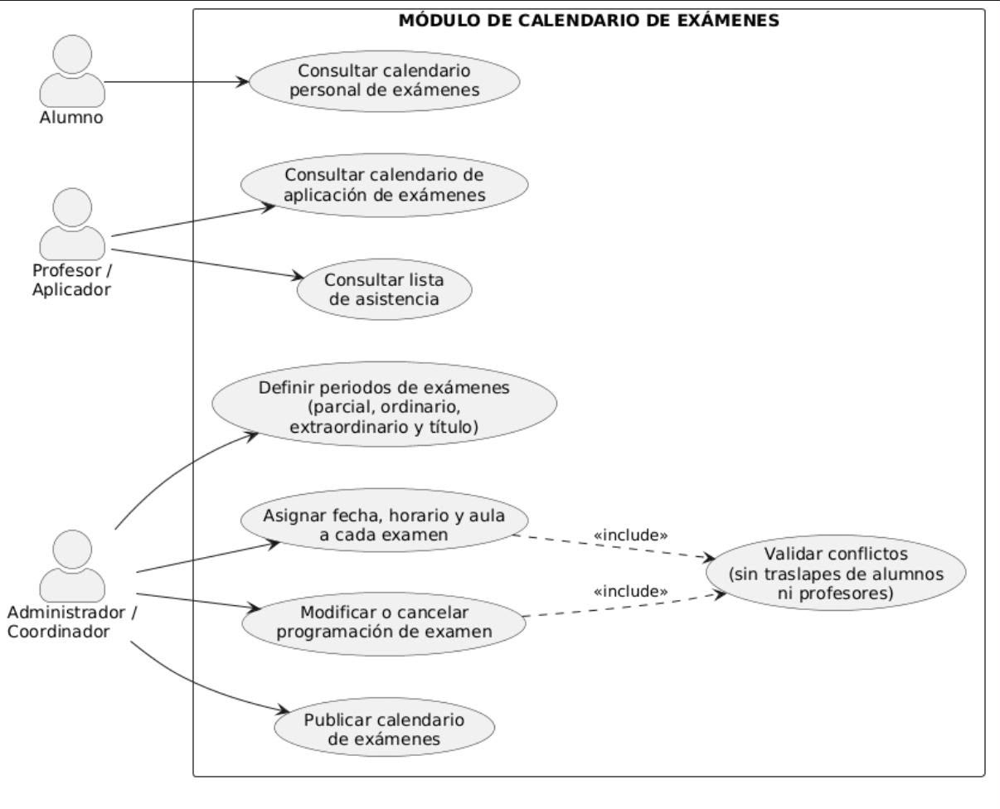
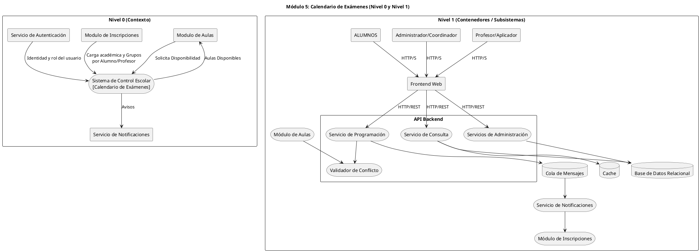
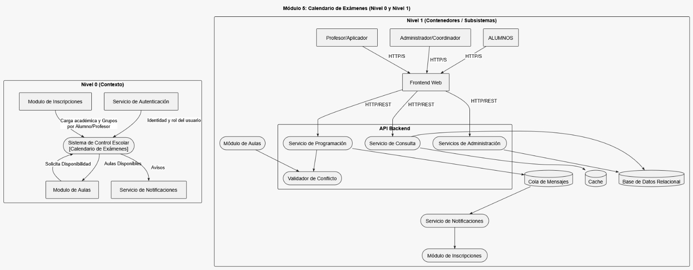

# Módulo Calendario de Exámenes

>
> Equipo 5
> (Jorge Uriel Vidal Morales, Melany Joana Toledo Escamilla, Alan Daniel Salas Gutierrez, Samuel Riveroll Vargas)
>

## Resumen
El **Módulo de Calendario de Exámenes** es la base para la planificación, organización y publicación de las evaluaciones académicas dentro del sistema de control escolar universitario. Su objetivo principal es automatizar y gestionar la programación de los diferentes tipos de evaluaciones (parciales, ordinarios, extraordinarios y título de suficiencia), garantizando la disponibilidad de aulas, evitando el traslape de horarios para alumnos y docentes, y facilitando la consulta centralizada en tiempo real.

## Objetivo y Alcance
### Objetivo
Automatizar y gestionar la planificación, organización y publicación de las evaluaciones académicas, asegurando la disponibilidad de espacios y evitando cruces de horarios para la comunidad estudiantil y docente.

### Alcance
Comprende la definición de periodos de evaluación, asignación de fechas, horarios y aulas, detección automática de conflictos por traslapes, publicación de calendarios y consultas personalizadas para alumnos, profesores y administradores.

## Requerimientos funcionales 
1. **RF-01 Programación de Periodos de Exámenes:** Permitir a la administración definir las ventanas de fechas hábiles para exámenes parciales y finales según el calendario lectivo.
2. **RF-02 Asignación de Horarios y Aulas:** Permitir la asignación de fecha, hora inicio/fin y aula física o virtual para cada asignatura.
3. **RF-03 Detección Automática de Conflictos (Validación de Traslape):** Validar que ningún estudiante o profesor tenga dos exámenes programados en el mismo bloque horario.
4. **RF-04 Consulta Personalizada del Estudiante:** Visualización del calendario de exámenes individual filtrado por la carga académica inscrita del alumno.
5. **RF-05 Consulta del Docente / Aplicador:** Visualización del calendario de aplicación de exámenes asignados y lista de asistencia.

## Actores
* **Administrador / Coordinador:** Usuario encargado de definir los periodos, asignar fechas, horarios y aulas, modificar o cancelar programaciones y publicar el calendario.
* **Alumno:** Usuario que consulta su calendario de exámenes personalizado según su carga académica.
* **Profesor / Aplicador:** Usuario que consulta su calendario de aplicación y las listas de asistencia correspondientes.

## Diagrama de casos de uso

## Descripción
- **UC1: Definir periodos de exámenes:** Permite al Administrador/Coordinador establecer las ventanas de fechas hábiles para las distintas evaluaciones académicas (parciales, ordinarios, extraordinarios y título de suficiencia).
  
- **UC2: Asignar fecha, horario y aula a cada examen:** Permite fijar los parámetros espacio-temporales para la aplicación de cada evaluación dentro del calendario lectivo.
  
- **UC3: Validar conflictos (sin traslapes) `<<include>>`:** Proceso automatizado ejecutado durante la asignación o modificación para garantizar que ningún alumno o docente tenga evaluaciones empalmadas en el mismo bloque de tiempo.
  
- **UC4: Modificar o cancelar programación de examen:** Permite ajustar parámetros o suspender evaluaciones previamente registradas actualizando el estado de la agenda.
  
- **UC5: Publicar calendario de exámenes:** Hace oficial la programación para que quede disponible para consulta pública dentro del sistema.
  
- **UC6: Consultar calendario personal de exámenes:** Permite al Alumno visualizar las fechas, horarios y aulas asignadas únicamente para las asignaturas en las que se encuentra inscrito.
  
- **UC7: Consultar calendario de aplicación de exámenes:** Muestra al Profesor/Aplicador el cronograma de los exámenes donde participará como responsable o aplicador.
  
- **UC8: Consultar lista de asistencia:** Permite al Profesor/Aplicador obtener la relación oficial de alumnos habilitados para presentar la evaluación en el aula correspondiente.

## Glosario y Abreviaturas
| Abreviatura / Término | Definición |
| :--- | :--- |
| **EX-PAR** | Examen Parcial: Evaluación periódica durante el semestre. |
| **EX-ORD** | Examen Ordinario: Evaluación final del curso regular. |
| **EX-EXT** | Examen Extraordinario: Evaluación de regularización para alumnos no acreditados. |
| **EX-TS** | Examen a Título de Suficiencia: Evaluación integral extraordinaria. |

## Requerimientos No funcionales
1. **RNF-01 Concurrencia:** Soportar la alta demanda de consultas por parte de los estudiantes al momento de la publicación del calendario.
##  Diagramas de Contexto (Nivel 0 y Nivel 1)

## Descripción
### Diagrama de Nivel 0 (Contexto)

- **Módulo de Aulas:** Mantiene una comunicación bidireccional solicitando disponibilidad de espacios y devolviendo el catálogo de aulas activas e instaladas.
  
- **Módulo de Inscripciones:** Provee la carga académica de asignaturas y la lista de grupos asociados tanto a alumnos como a docentes.
  
- **Servicio de Autenticación:** Transmite la validación de identidad y el rol activo del usuario para determinar los permisos de operación dentro del sistema.
  
- **Sistema de Control Escolar (Calendario de Exámenes):** Procesa los datos recibidos para programar las evaluaciones y coordinar los recursos.
  
- **Servicio de Notificaciones:** Recibe la emisión de avisos y alertas del calendario para distribuirlos a los usuarios involucrados.
  

### Diagrama de Nivel 1 (Contenedores / Subsistemas)

- **Actores (Profesor/Aplicador, Administrador/Coordinador, ALUMNOS):** Interfazan con el sistema mediante peticiones seguras (`HTTP/S`) hacia la capa cliente.
  
- **Frontend Web:** Captura las interacciones de los usuarios y distribuye las peticiones mediante llamadas `HTTP/REST` hacia los servicios backend.
  
- **Servicios de Administración:** Gestionan la persistencia de configuraciones, modificaciones de periodos y parámetros.
  
  
- **Servicio de Programación:** Registra los eventos de examen, coordina la validación de espacios y publica eventos hacia la Cola de Mensajes.
  
- **Validador de Conflicto:** Proceso automatizado que interactúa con el Módulo de Aulas para asegurar la disponibilidad sin cruce de horarios.
  
- **Cola de Mensajes & Notificaciones:** Asincroniza la entrega de eventos hacia el Servicio de Notificaciones.
