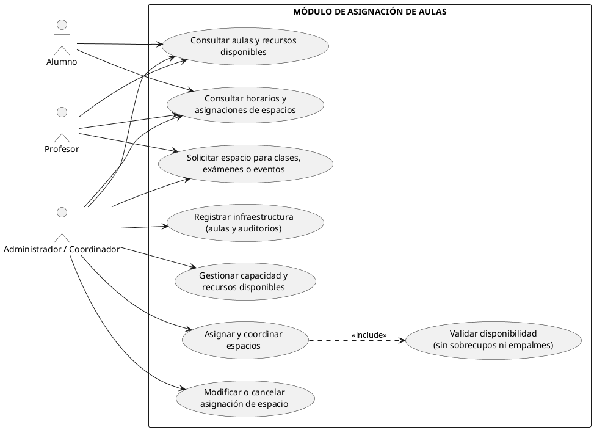
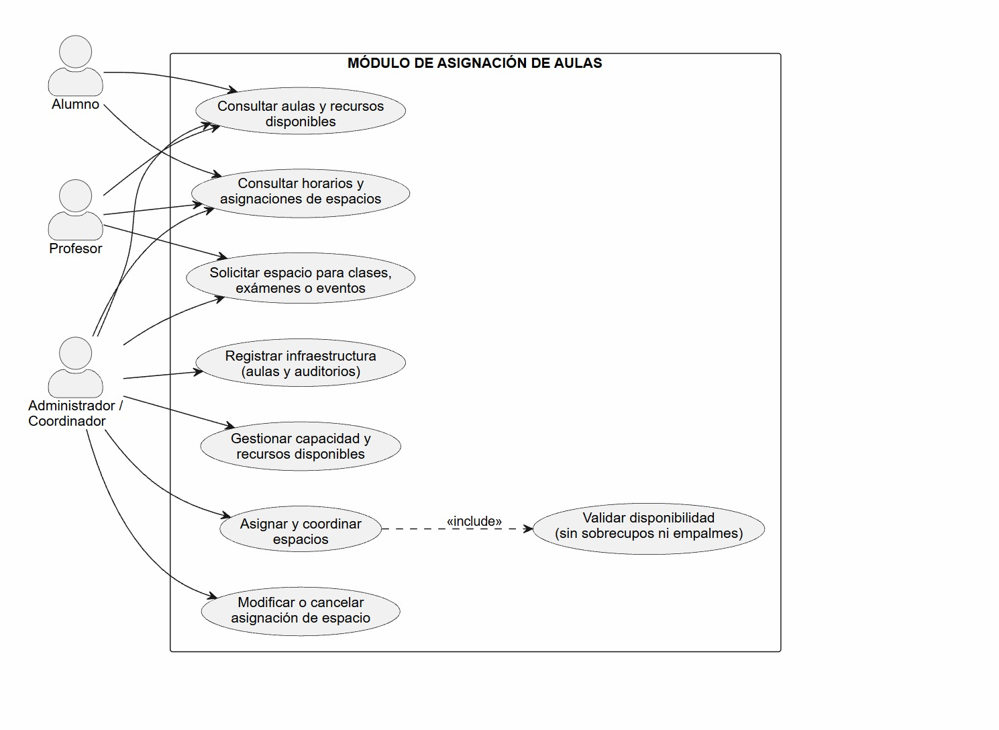

# Modulo Aulas

>
> Equipo 5
> (Jorge Uriel Vidal Morales, Melany Joana Toledo Escamilla, Alan Daniel Salas Gutierrez, Samuel Riveroll Vargas)
>

## Resumen
El **Módulo de Asignación de Aulas** es fundamental para el control, administración y optimización de los espacios físicos y virtuales de la institución educativa. Su objetivo principal es gestionar la infraestructura escolar (aulas y auditorios), registrar su capacidad y recursos disponibles, y coordinar la asignación de espacios para clases regulares, exámenes y eventos especiales, garantizando que no existan sobrecupos ni empalmes de horarios.

## Objetivo y Alcance
### Objetivo
Gestionar la infraestructura escolar (aulas y auditorios) y coordinar la asignación de espacios para clases regulares, exámenes y eventos especiales, garantizando que no existan sobrecupos ni empalmes de horarios.

### Alcance
Control, administración y optimización de los espacios físicos y virtuales de la institución educativa, registrando su capacidad y recursos disponibles para clases, exámenes y eventos.

## Requerimientos funcionales 
1. **RF-01 Registro y Gestión de Espacios:** Permitir dar de alta, modificar y dar de baja aulas y recintos, especificando número, edificio, tipo y capacidad de alumnos (ej. capacidad fija de 20 alumnos).
2. **RF-02 Control de Recursos e Instalaciones:** Registrar el equipamiento disponible en cada espacio (proyectores, computadoras, conectores).
3. **RF-03 Detección de Conflictos de Traslape de Espacio:** Validar en tiempo real que ningún aula sea asignado a dos clases, exámenes o eventos en el mismo bloque de horario.
4. **RF-04 Validación de Aforo y Capacidad:** Verificar que el total de alumnos inscritos en un grupo o examen no supere la capacidad máxima del aula asignada.

## Actores
* **Administrador / Gestor de Infraestructura:** Usuario encargado de dar de alta, modificar y dar de baja aulas y recintos, así como registrar el equipamiento disponible.
* **Coordinador Académico:** Usuario que coordina la asignación de espacios para clases regulares, exámenes y eventos especiales.
* **Sistema (Automatizado):** Componente encargado de validar en tiempo real los traslapes de horarios y la verificación del aforo y capacidad.

## Diagrama de casos de uso




## Descripción
- **UC1: Consultar aulas y recursos disponibles:** Permite a alumnos, profesores y administradores filtrar y visualizar el catálogo de aulas activas junto con su equipamiento instalado.
  
- **UC2: Consultar horarios y asignaciones de espacios:** Muestra la cuadrícula de ocupación por día y hora para verificar qué espacios están reservados o libres.
  
- **UC3: Solicitar espacio para clases, exámenes o eventos:** Permite a docentes y coordinadores enviar una solicitud indicando fecha, horario, aforo y tipo de actividad.
  
- **UC4: Registrar infraestructura (aulas y auditorios):** Utilizado por la administración para dar de alta, modificar datos o retirar recintos del inventario escolar.
  
- **UC5: Gestionar capacidad y recursos disponibles:** Actualiza el aforo máximo permitido e inventario de instalaciones (tecnología y mobiliario) asociadas a un aula.
  
- **UC6: Asignar y coordinar espacios:** Vincula un grupo o evento a un aula específica en un bloque de tiempo determinado.
  
- **UC7: Validar disponibilidad (sin sobrecupos ni empalmes) `<<include>>`:** Proceso automatizado que verifica en tiempo real que el aula esté libre y que los inscritos no superen la capacidad máxima.
  
- **UC8: Modificar o cancelar asignación de espacio:** Permite ajustar los parámetros de una reserva existente o liberar el aula para dejarla disponible nuevamente.

## Glosario y Abreviaturas
| Abreviatura / Término | Definición |
| :--- | :--- |
| **AUL-TEO** | Aula Teórica: Espacio físico destinado a clases magistrales o teóricas. |
| **AUD-CEN** | Auditorio Central: Espacio de alta capacidad para conferencias o evaluaciones masivas. |
| **CAP-AUL** | Capacidad del Aula: Límite máximo de alumnos permitidos por normativa de espacio/aforo. |

## Requerimientos No funcionales
1. **RNF-01 Tiempo de Respuesta en Validaciones:** Garantizar que la verificación de disponibilidad e idoneidad del aula se realice en menos de 5 segundos durante el proceso de programación de horarios y exámenes.

##  Diagramas de Contexto (Nivel 0 y Nivel 1)
```plantuml

@startuml Modulo8_Calendario_Examenes_Completo
title Módulo 8: Calendario de Exámenes (Cumplimiento de Rúbrica)

skinparam defaultTextAlignment center
skinparam packageStyle rectangle
skinparam shadowing false

package "Nivel 0 (Contexto)" {
    rectangle "Administrador / Coordinador" as admin0
    rectangle "Profesor / Aplicador" as prof0
    rectangle "Alumno" as alum0
    
    storage "Sistema de Información\nde Calendario de Exámenes" as sistema0
    
    admin0 --> sistema0 : programación de periodos
    prof0 --> sistema0 : consulta de aplicación
    alum0 --> sistema0 : consulta personal
    
    sistema0 --> admin0 : alertas de traslape
    sistema0 --> prof0 : lista de asistencia
    sistema0 --> alum0 : fecha y aula de examen
}

package "Nivel 1 (Contenedores / Subsistemas)" {
    rectangle "Usuarios\n(Admin / Prof / Alumno)" as user1
    
    rectangle "Aplicación Web / Móvil\n(Front-End)" as app1
    
    storage "API Gateway /\nServicios Back-End" as gateway1
    
    storage "1. Programador de E

```


## Descripción

### Diagrama de Nivel 0 (Contexto)

- **Módulo de Aulas:** Mantiene una comunicación bidireccional solicitando disponibilidad de espacios y devolviendo el catálogo de aulas activas.
  
- **Módulo de Inscripciones:** Provee la carga académica de asignaturas y la lista de grupos asociados tanto a alumnos como a docentes.
  
- **Servicio de Autenticación:** Transmite la validación de identidad y el rol activo del usuario para determinar los permisos de operación dentro del sistema.
  
- **Sistema de Control Escolar (Calendario de Exámenes):** Procesa los datos recibidos para programar las evaluaciones y coordinar los recursos.
  
- **Servicio de Notificaciones:** Recibe la emisión de avisos y alertas del calendario para distribuirlos a los usuarios involucrados.
  

### Diagrama de Nivel 1 (Contenedores / Subsistemas)

- **Actores (Profesor/Aplicador, Administrador/Coordinador, ALUMNOS):** Interfazan con el sistema mediante peticiones seguras (`HTTP/S`) hacia la capa cliente.
 
  
- **Servicios de Administración:** Gestionan la persistencia de configuraciones, modificaciones de periodos y parámetros.
  
- **Servicio de Consulta:** Atiende las búsquedas del usuario optimizando la lectura.
  
- **Servicio de Programación:** Registra los eventos de examen, coordina la validación de espacios y publica eventos.
  
- **Validador de Conflicto:** Proceso automatizado que interactúa con el Módulo de Aulas para asegurar la disponibilidad sin cruce de horarios.
