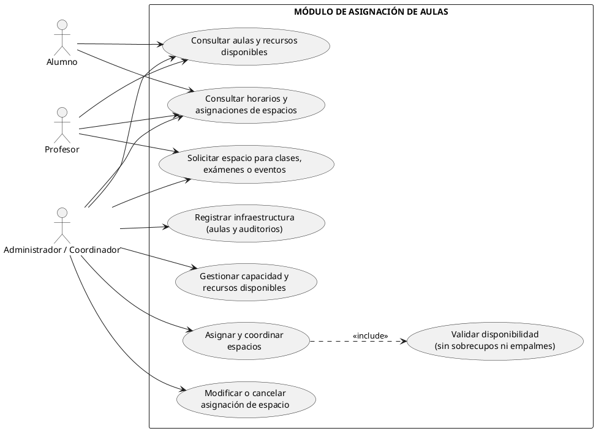
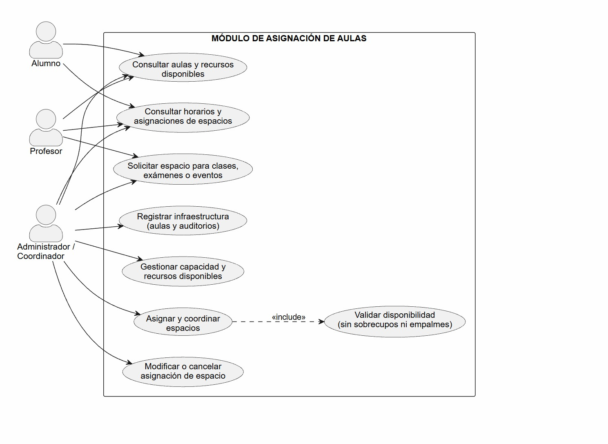
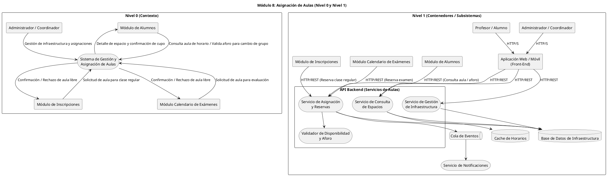
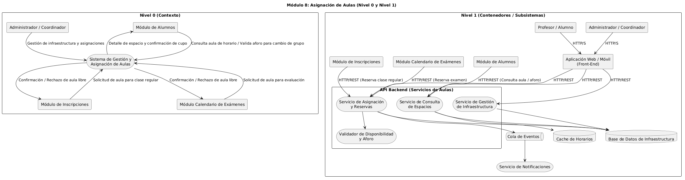

# Modulo Aulas

>
> Equipo 5
> (Jorge Uriel Vidal Morales, Melany Joana Toledo Escamilla, Alan Daniel Salas Gutierrez, Samuel Riveroll Vargas)
>

## Resumen
El **Módulo de Asignación de Aulas** es fundamental para el control, administración y optimización de los espacios físicos y virtuales de la institución educativa. Su objetivo principal es gestionar la infraestructura escolar (aulas y auditorios), registrar su capacidad y recursos disponibles, y coordinar la asignación de espacios para clases regulares, exámenes y eventos especiales, garantizando que no existan sobrecupos ni empalmes de horarios.

## Objetivo y Alcance
### Objetivo
Gestionar la infraestructura escolar (aulas y auditorios) y coordinar la asignación de espacios para clases regulares, exámenes y eventos especiales, garantizando que no existan sobrecupos ni empalmes de horarios.

### Alcance
Control, administración y optimización de los espacios físicos y virtuales de la institución educativa, registrando su capacidad y recursos disponibles para clases, exámenes y eventos.

## Requerimientos funcionales 
1. **RF-01 Registro y Gestión de Espacios:** Permitir dar de alta, modificar y dar de baja aulas y recintos, especificando número, edificio, tipo y capacidad de alumnos (ej. capacidad fija de 20 alumnos).
2. **RF-02 Control de Recursos e Instalaciones:** Registrar el equipamiento disponible en cada espacio (proyectores, computadoras, conectores).
3. **RF-03 Detección de Conflictos de Traslape de Espacio:** Validar en tiempo real que ningún aula sea asignado a dos clases, exámenes o eventos en el mismo bloque de horario.
4. **RF-04 Validación de Aforo y Capacidad:** Verificar que el total de alumnos inscritos en un grupo o examen no supere la capacidad máxima del aula asignada.

## Actores
* **Administrador / Gestor de Infraestructura:** Usuario encargado de dar de alta, modificar y dar de baja aulas y recintos, así como registrar el equipamiento disponible.
* **Coordinador Académico:** Usuario que coordina la asignación de espacios para clases regulares, exámenes y eventos especiales.
* **Sistema (Automatizado):** Componente encargado de validar en tiempo real los traslapes de horarios y la verificación del aforo y capacidad.

## Diagrama de casos de uso

## Descripción
- **UC1: Consultar aulas y recursos disponibles:** Permite a alumnos, profesores y administradores filtrar y visualizar el catálogo de aulas activas junto con su equipamiento instalado.
  
- **UC2: Consultar horarios y asignaciones de espacios:** Muestra la cuadrícula de ocupación por día y hora para verificar qué espacios están reservados o libres.
  
- **UC3: Solicitar espacio para clases, exámenes o eventos:** Permite a docentes y coordinadores enviar una solicitud indicando fecha, horario, aforo y tipo de actividad.
  
- **UC4: Registrar infraestructura (aulas y auditorios):** Utilizado por la administración para dar de alta, modificar datos o retirar recintos del inventario escolar.
  
- **UC5: Gestionar capacidad y recursos disponibles:** Actualiza el aforo máximo permitido e inventario de instalaciones (tecnología y mobiliario) asociadas a un aula.
  
- **UC6: Asignar y coordinar espacios:** Vincula un grupo o evento a un aula específica en un bloque de tiempo determinado.
  
- **UC7: Validar disponibilidad (sin sobrecupos ni empalmes) `<<include>>`:** Proceso automatizado que verifica en tiempo real que el aula esté libre y que los inscritos no superen la capacidad máxima.
  
- **UC8: Modificar o cancelar asignación de espacio:** Permite ajustar los parámetros de una reserva existente o liberar el aula para dejarla disponible nuevamente.

## Glosario y Abreviaturas
| Abreviatura / Término | Definición |
| :--- | :--- |
| **AUL-TEO** | Aula Teórica: Espacio físico destinado a clases magistrales o teóricas. |
| **AUD-CEN** | Auditorio Central: Espacio de alta capacidad para conferencias o evaluaciones masivas. |
| **CAP-AUL** | Capacidad del Aula: Límite máximo de alumnos permitidos por normativa de espacio/aforo. |

## Requerimientos No funcionales
1. **RNF-01 Tiempo de Respuesta en Validaciones:** Garantizar que la verificación de disponibilidad e idoneidad del aula se realice en menos de 5 segundos durante el proceso de programación de horarios y exámenes.

##  Diagramas de Contexto (Nivel 0 y Nivel 1)

## Descripción

## Diagrama de Nivel 0 (Contexto)

* *Administrador / Coordinador:* Interactúa con el sistema registrando la infraestructura física, definiendo aforos y gestionando directamente las asignaciones manuales o correcciones.
* *Módulo de Alumnos:* Envía peticiones de consulta sobre la ubicación física del aula para su horario o verifica la disponibilidad de aforo en caso de solicitudes de cambio de grupo.
* *Módulo Calendario de Exámenes:* Emite solicitudes de reserva de espacios (aulas o auditorios) para la aplicación de evaluaciones parciales, ordinarias, extraordinarias y de título.
* *Módulo de Inscripciones:* Solicita la asignación e idoneidad de espacios físicos para el catálogo de clases regulares del periodo académico.

---

## Diagrama de Nivel 1 (Contenedores / Subsistemas)

### Capa de Presentación
* *Front-End:* Interfaz web/móvil para que administradores, docentes y alumnos gestionen y consulten espacios mediante llamadas HTTP/S seguras.

### Servicios Backend
* *Servicios de Infraestructura (infraSvc1):* Administra el catálogo de recintos, capacidad máxima, edificios e inventarios de equipamiento (tecnología, proyectores).
* *Servicio de Asignación y Reservas (reserSvc1):* Procesa y coordina las solicitudes de espacio recibidas tanto desde el Front-End como desde los módulos externos (Inscripciones y Exámenes).
* *Validador de Disponibilidad y Aforo (validSvc1):* Subcomponente especializado que efectúa en tiempo real las comprobaciones algorítmicas de ocupación de horario y validación de aforo antes de confirmar cualquier reserva.
* *Servicio de Consulta de Espacios (consultaSvc1):* Atiende las búsquedas de horarios y aulas aprovechando la capa de *Caché de Horarios* para asegurar respuestas de alta velocidad.

### Infraestructura de Soporte
* *Procesamiento Asíncrono y Eventos:* Emplea una *Cola de Eventos* para desacoplar el envío de notificaciones hacia los usuarios u otros subsistemas al confirmarse un cambio o asignación de espacio.
