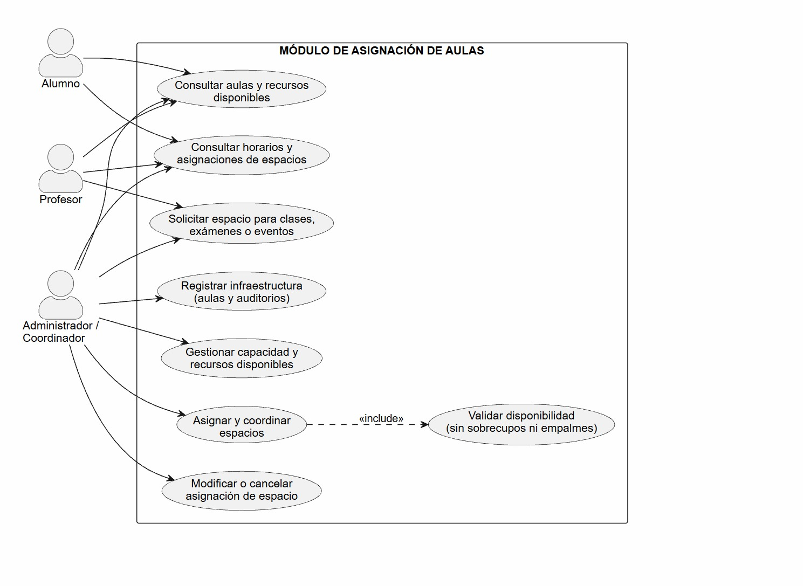
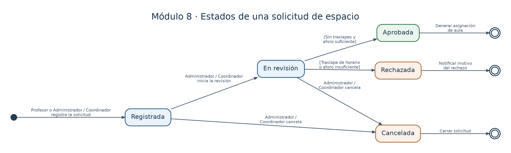
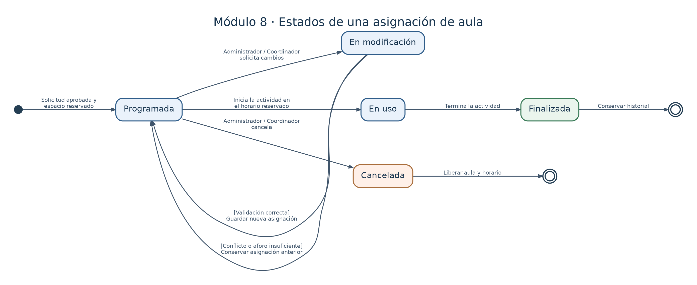

# Módulo 8: Asignación de Aulas

> **Equipo 5**  
> **Integrantes:** Jorge Uriel Vidal Morales, Melany Joana Toledo Escamilla, Alan Daniel Salas Gutierrez y Samuel Riveroll Vargas.

## Resumen

El **Módulo de Asignación de Aulas** es fundamental para el control, administración y optimización de los espacios físicos y virtuales de la institución educativa. Su objetivo principal es gestionar la infraestructura escolar (aulas y auditorios), registrar su capacidad y recursos disponibles, y coordinar la asignación de espacios para clases regulares, exámenes y eventos especiales, garantizando que no existan sobrecupos ni empalmes de horarios.

## Objetivo y Alcance

### Objetivo

Gestionar la infraestructura escolar (aulas y auditorios) y coordinar la asignación de espacios para clases regulares, exámenes y eventos especiales, garantizando la disponibilidad de espacios y evitando cruces de horarios para la comunidad estudiantil y docente.

### Alcance

Control, administración y optimización de los espacios físicos y virtuales de la institución educativa, registrando su capacidad y recursos disponibles para clases, exámenes y eventos.

## Requerimientos funcionales

**RF-01. Registro y administración de espacios**

El sistema deberá permitir al Administrador / Coordinador registrar, modificar y dar de baja aulas, auditorios y otros espacios institucionales, especificando su identificador, edificio, tipo de espacio, capacidad máxima y estado de disponibilidad.

**RF-02. Administración de recursos e instalaciones**

El sistema deberá permitir al Administrador / Coordinador registrar y actualizar los recursos disponibles en cada espacio, como proyectores, computadoras, mobiliario y otros equipos necesarios para las actividades académicas.

**RF-03. Detección de conflictos de horarios**

El sistema deberá verificar que un aula o espacio no se encuentre asignado a más de una clase, examen o evento durante un mismo intervalo de tiempo. En caso de detectar un traslape, deberá impedir la asignación e informar el conflicto.

**RF-04. Validación de aforo y capacidad**

El sistema deberá comprobar que la cantidad de personas previstas para una clase, examen o evento no exceda la capacidad máxima registrada para el espacio solicitado. Si se supera el aforo permitido, deberá rechazar la asignación e informar el motivo.

**RF-05. Consulta de aulas y recursos disponibles**

El sistema deberá permitir a los usuarios autorizados consultar el catálogo de aulas y espacios institucionales, mostrando su ubicación, capacidad, tipo de espacio, estado y recursos disponibles.

**RF-06. Consulta de horarios y asignaciones de espacios**

El sistema deberá permitir consultar los horarios de ocupación de aulas y auditorios, identificando los espacios disponibles y ocupados durante las fechas y horarios seleccionados.

**RF-07. Solicitud de espacios académicos**

El sistema deberá permitir al Profesor y al Administrador / Coordinador registrar solicitudes de espacios para clases, exámenes o eventos, indicando el tipo de actividad, fecha, horario, cantidad estimada de asistentes y recursos requeridos.

**RF-08. Asignación y confirmación de espacios**

El sistema deberá permitir al Administrador / Coordinador asignar un aula o espacio institucional a una actividad académica. Antes de confirmar la asignación, deberá verificar la disponibilidad, evitar traslapes y comprobar el cumplimiento de la capacidad máxima permitida.

**RF-09. Modificación y cancelación de asignaciones**

El sistema deberá permitir al Administrador / Coordinador modificar o cancelar asignaciones de espacios existentes. Las modificaciones deberán someterse nuevamente a las validaciones de disponibilidad y aforo. Cuando una asignación sea cancelada, el espacio deberá quedar disponible para nuevas reservas en el horario correspondiente.

## Actores

| Actor | Descripción |
|---|---|
| Administrador / Coordinador | Personal de la institución educativa con autoridad administrativa y académica sobre la gestión de infraestructura y organización de espacios escolares. |
| Profesor | Personal docente de la institución educativa que participa en actividades académicas y hace uso de los espacios destinados a la enseñanza y evaluación. |
| Alumno | Estudiante inscrito en la institución educativa que utiliza los espacios escolares para asistir a clases, evaluaciones y otras actividades académicas. |

## Diagrama de casos de uso

El diagrama representa las interacciones entre los actores Alumno, Profesor y Administrador / Coordinador con las funciones del Módulo de Asignación de Aulas.

**Código fuente UML:** [Ver diagrama de casos de uso](../docs/architecture/diagrams/e5_m8_aulas_casos_uso.uml)

**Imagen PNG:** [Ver imagen de casos de uso](resources/imgs/m8_Aulas_casos_uso.png)

### Descripción de los casos de uso

- **UC1: Consultar aulas y recursos disponibles:** Permite a alumnos, profesores y administradores filtrar y visualizar el catálogo de aulas activas junto con su equipamiento instalado.

- **UC2: Consultar horarios y asignaciones de espacios:** Muestra la cuadrícula de ocupación por día y hora para verificar qué espacios están reservados o libres.

- **UC3: Solicitar espacio para clases, exámenes o eventos:** Permite a docentes y coordinadores enviar una solicitud indicando fecha, horario, aforo y tipo de actividad.

- **UC4: Registrar infraestructura (aulas y auditorios):** Utilizado por la administración para dar de alta, modificar datos o retirar recintos del inventario escolar.

- **UC5: Gestionar capacidad y recursos disponibles:** Actualiza el aforo máximo permitido e inventario de instalaciones (tecnología y mobiliario) asociadas a un aula.

- **UC6: Asignar y coordinar espacios:** Vincula un grupo o evento a un aula específica en un bloque de tiempo determinado.

- **UC7: Validar disponibilidad (sin sobrecupos ni empalmes):** Proceso automatizado que verifica en tiempo real que el aula esté libre y que los inscritos no superen la capacidad máxima. Este caso de uso se incluye dentro de UC6.

- **UC8: Modificar o cancelar asignación de espacio:** Permite ajustar los parámetros de una reserva existente o liberar el aula para dejarla disponible nuevamente.

## Diagrama de estados

Los siguientes diagramas representan los cambios de estado de dos objetos involucrados en el Módulo de Asignación de Aulas: la solicitud de espacio y la asignación de aula.

### Diagrama 1. Estados de la solicitud de espacio

Representa el ciclo de vida de una solicitud iniciada por un Profesor o por el Administrador / Coordinador.

La solicitud se registra y posteriormente se revisa para verificar la disponibilidad del espacio y el cumplimiento de la capacidad permitida.

Dependiendo del resultado de las validaciones, la solicitud podrá ser aprobada o rechazada. Una solicitud aprobada puede dar origen a una asignación de aula.

**Código fuente UML:** [Ver estados de solicitud de espacio](../docs/architecture/diagrams/e5_m8_aulas_estados_solicitud.uml)

**Imagen PNG:** [Ver imagen del diagrama](../docs/architecture/diagrams/e5_m8_aulas_estados_solicitud.png)

### Diagrama 2. Estados de la asignación de aula

Representa el ciclo de vida de una asignación de aula previamente aprobada.

Una asignación confirmada puede mantenerse programada hasta el inicio de la actividad, modificarse, cancelarse o finalizar cuando concluya el periodo de utilización del espacio.

En caso de modificaciones, el sistema deberá comprobar nuevamente la disponibilidad del aula y el cumplimiento del aforo permitido.

**Código fuente UML:** [Ver estados de asignación de aula](../docs/architecture/diagrams/e5_m8_aulas_estados_asignacion.uml)

**Imagen PNG:** [Ver imagen del diagrama](../docs/architecture/diagrams/e5_m8_aulas_estados_asignacion.png)

## Glosario y Abreviaturas

| Abreviatura / Término | Definición |
|---|---|
| **AUL-TEO** | Aula Teórica: Espacio físico destinado a clases magistrales o teóricas. |
| **AUD-CEN** | Auditorio Central: Espacio de alta capacidad para conferencias o evaluaciones masivas. |
| **CAP-AUL** | Capacidad del Aula: Límite máximo de alumnos permitidos por normativa de espacio/aforo. |

## Requerimientos No funcionales

**RNF-01. Tiempo de respuesta en validaciones**

Garantizar que la verificación de disponibilidad e idoneidad del aula se realice en menos de 5 segundos durante el proceso de programación de horarios y exámenes.

## Diagramas de Contexto (Nivel 0 y Nivel 1)

Los diagramas de contexto representan las interacciones del Módulo de Asignación de Aulas con los usuarios, módulos externos y componentes internos del Sistema de Control Escolar.

El Nivel 0 muestra las relaciones generales con otros módulos, mientras que el Nivel 1 presenta la distribución de componentes y servicios internos.

**Código fuente UML:** [Ver diagramas de contexto](../docs/architecture/diagrams/e5_m8_aulas_contexto.uml)

**Imagen PNG:** [Ver imagen de diagramas de contexto](resources/imgs/m8_Aulas_contexto.png)

### Descripción del diagrama de nivel 0 (Contexto)

- **Administrador / Coordinador:** Interactúa con el sistema registrando la infraestructura física, definiendo aforos y gestionando directamente las asignaciones manuales o correcciones.

- **Módulo de Alumnos:** Envía peticiones de consulta sobre la ubicación física del aula para su horario o verifica la disponibilidad de aforo en caso de solicitudes de cambio de grupo.

- **Módulo Calendario de Exámenes:** Emite solicitudes de reserva de espacios (aulas o auditorios) para la aplicación de evaluaciones parciales, ordinarias, extraordinarias y de título.

- **Módulo de Inscripciones:** Solicita la asignación e idoneidad de espacios físicos para el catálogo de clases regulares del periodo académico.

### Descripción del diagrama de nivel 1 (Contenedores / Subsistemas)

#### Capa de Presentación

- **Front-End:** Interfaz web/móvil para que administradores, docentes y alumnos gestionen y consulten espacios mediante llamadas HTTP/S seguras.

#### Servicios Backend

- **Servicios de Infraestructura (infraSvc1):** Administra el catálogo de recintos, capacidad máxima, edificios e inventarios de equipamiento (tecnología, proyectores).

- **Servicio de Asignación y Reservas (reserSvc1):** Procesa y coordina las solicitudes de espacio recibidas tanto desde el Front-End como desde los módulos externos (Inscripciones y Exámenes).

- **Validador de Disponibilidad y Aforo (validSvc1):** Subcomponente especializado que efectúa en tiempo real las comprobaciones algorítmicas de ocupación de horario y validación de aforo antes de confirmar cualquier reserva.

- **Servicio de Consulta de Espacios (consultaSvc1):** Atiende las búsquedas de horarios y aulas aprovechando la capa de Caché de Horarios para asegurar respuestas de alta velocidad.

#### Infraestructura de Soporte

- **Procesamiento Asíncrono y Eventos:** Emplea una Cola de Eventos para desacoplar el envío de notificaciones hacia los usuarios u otros subsistemas al confirmarse un cambio o asignación de espacio.
