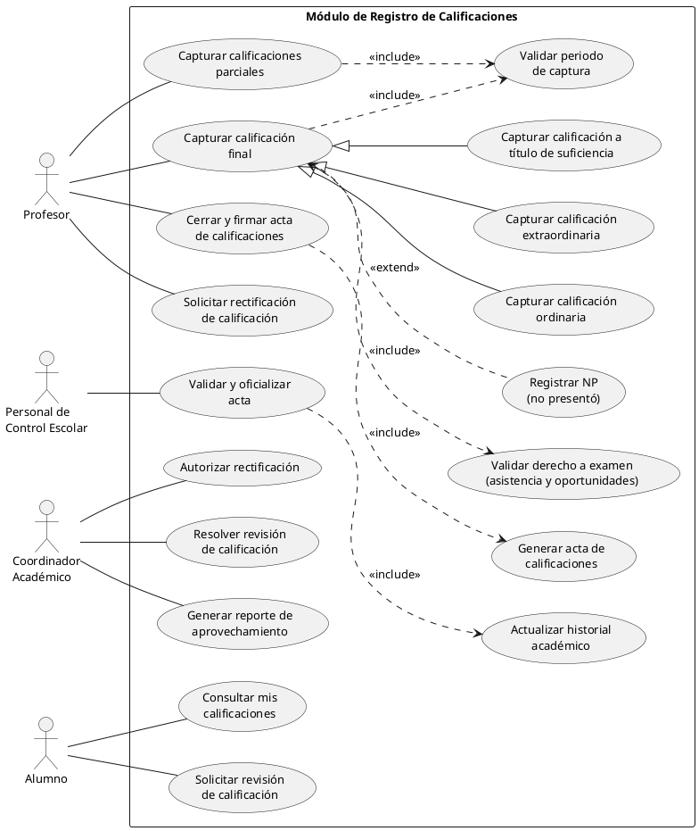
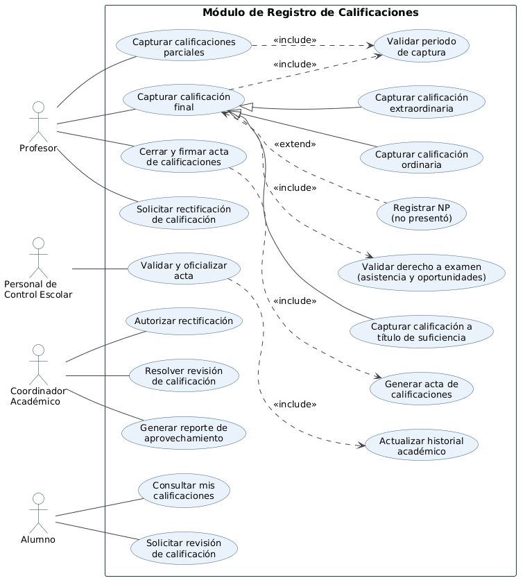

# Módulo Registro de Calificaciones

> Equipo 6  
> **Integrantes:** Luis Fernando Guerrero Pedroza; Tendzin Angello Diaz Estrada; Erick Daniel Rosales González; Gabriell Quetzalli Santana Reyes

## Resumen
Permite a los profesores capturar calificaciones parciales y finales, generar y cerrar actas; a Control Escolar oficializarlas; y a alumnos consultar resultados y solicitar revisiones. Incluye correcciones autorizadas y reportes académicos.

## Objetivo y Alcance
**Objetivo:** Registrar y consultar calificaciones por alumno, asignatura y grupo con integridad, trazabilidad y aplicación uniforme de las reglas de evaluación.

**Alcance:** Captura de resultados parciales, ordinarios, extraordinarios y a título de suficiencia; validación de elegibilidad y periodos; actas; revisiones, rectificaciones y reportes. La programación de exámenes corresponde al módulo Calendario de Exámenes.

## Requerimientos funcionales
- **RF-01:** Capturar calificaciones parciales y finales por grupo.
- **RF-02:** Distinguir calificaciones ordinarias, extraordinarias y a título de suficiencia.
- **RF-03:** Validar el periodo de captura vigente.
- **RF-04:** Verificar requisitos y oportunidades del examen definidos en el catálogo.
- **RF-05:** Registrar NP (no presentó), cuando corresponda.
- **RF-06:** Generar, cerrar y firmar el acta de calificaciones.
- **RF-07:** Oficializar actas y actualizar el historial académico.
- **RF-08:** Solicitar y autorizar rectificaciones documentadas.
- **RF-09:** Consultar resultados y solicitar/resolver revisiones.
- **RF-10:** Emitir reportes de aprovechamiento por grupo o asignatura.

## Actores
| Actor | Función |
|---|---|
| Profesor | Captura resultados, cierra actas y solicita rectificaciones. |
| Personal de Control Escolar | Valida y oficializa actas; registra resultados oficiales. |
| Coordinador Académico | Autoriza rectificaciones, resuelve revisiones y consulta reportes. |
| Alumno | Consulta sus calificaciones y solicita revisiones. |

## Diagrama de casos de uso

## Glosario y Abreviaturas
- **NP:** No presentó.
- **Acta de calificaciones:** Registro formal de los resultados de un grupo.
- **Revisión:** Solicitud del alumno para verificar un resultado publicado.
- **Rectificación:** Corrección autorizada de una calificación.
- **Ordinario / extraordinario / título de suficiencia:** Modalidades de evaluación definidas por el catálogo.

## Requerimientos No funcionales
- **RNF-01:** Proteger las calificaciones mediante autenticación y autorización por rol.
- **RNF-02:** Registrar en bitácora las modificaciones, motivos, responsables y fechas.
- **RNF-03:** Impedir la edición directa de actas oficializadas; usar rectificación autorizada.
- **RNF-04:** Mantener consistencia entre calificaciones, inscripciones, asignaturas y actas.
- **RNF-05:** Mostrar los resultados en una interfaz legible y accesible.

## Reglas de negocio e integración
Las calificaciones deben vincularse a alumnos inscritos y profesores asignados. Los requisitos, porcentajes y oportunidades se consultan en el **Catálogo de Exámenes**, evitando duplicación. El **Calendario de Exámenes** determina las evaluaciones programadas. La escala numérica, mínimos aprobatorios, asistencias y plazos de revisión deben corresponder al reglamento académico aplicable.
