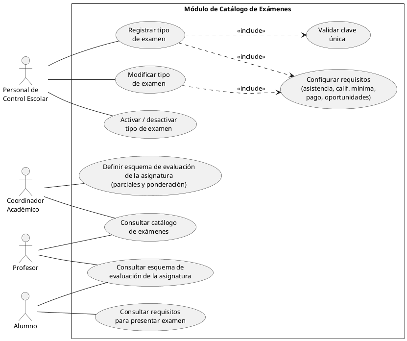
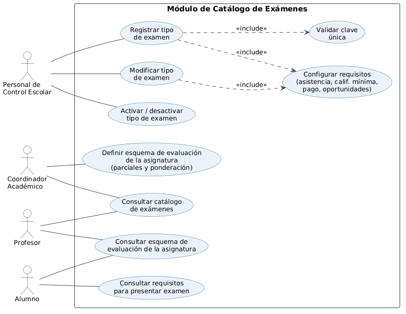

# Módulo Catálogo de Exámenes

> Equipo 6  
> **Integrantes:** Luis Fernando Guerrero Pedroza; Tendzin Angello Diaz Estrada; Erick Daniel Rosales González; Gabriell Quetzalli Santana Reyes

## Resumen
Administra los tipos de examen (parcial, ordinario, extraordinario y título de suficiencia) y los criterios asociados: asistencia, calificación mínima, pagos cuando apliquen y número de oportunidades. También permite definir esquemas de evaluación por asignatura. Estos datos son consultados por los módulos de Calendario de Exámenes y Registro de Calificaciones.

## Objetivo y Alcance
**Objetivo:** Centralizar los tipos y requisitos académicos de las evaluaciones para evitar reglas inconsistentes entre módulos.

**Alcance:** Registro y actualización de tipos, control de vigencia, requisitos, esquemas de evaluación y consultas; no incluye la asignación de fecha, hora, aula o aplicador.

## Requerimientos funcionales
- **RF-01:** Registrar tipos de examen con clave única, nombre y descripción.
- **RF-02:** Configurar requisitos como asistencia mínima, pago y oportunidades, según normativa.
- **RF-03:** Modificar datos de un tipo de examen.
- **RF-04:** Activar o desactivar tipos sin eliminar su historial.
- **RF-05:** Establecer esquemas de evaluación por asignatura y sus ponderaciones.
- **RF-06:** Consultar catálogo y esquemas de evaluación.
- **RF-07:** Consultar requisitos para presentar cada tipo de examen.

## Actores
| Actor | Función |
|---|---|
| Personal de Control Escolar | Registra, modifica y activa o desactiva tipos de examen. |
| Coordinador Académico | Define esquemas de evaluación y consulta el catálogo. |
| Profesor | Consulta tipos y esquemas aplicables. |
| Alumno | Consulta requisitos y esquemas de evaluación. |

## Diagrama de casos de uso

## Glosario y Abreviaturas
- **Tipo de examen:** Clasificación administrativa y académica de una evaluación.
- **Esquema de evaluación:** Conjunto de evaluaciones que conforman la calificación de una asignatura.
- **Ponderación:** Peso porcentual de una evaluación.
- **Oportunidad:** Intento disponible para presentar una modalidad de examen.
- **Vigencia:** Periodo durante el que rigen los requisitos registrados.

## Requerimientos No funcionales
- **RNF-01:** Proteger la edición del catálogo con permisos por rol.
- **RNF-02:** Mantener trazabilidad de cambios y preservar registros históricos.
- **RNF-03:** Validar claves únicas y que las ponderaciones sumen 100 % cuando proceda.
- **RNF-04:** Proporcionar consultas consistentes a los módulos relacionados.
- **RNF-05:** Mantener disponibilidad y claridad de la información para docentes y alumnos.

## Reglas de negocio e integración
Los tipos deben tener una clave única y estado activo o inactivo. Los tipos usados en evaluaciones previas no deben eliminarse físicamente. Los criterios reglamentarios se parametrizan y se actualizan bajo autorización. Los módulos **Calendario de Exámenes**, **Registro de Calificaciones**, **Asignaturas** y **Periodos Escolares** consultan o relacionan esta información.
