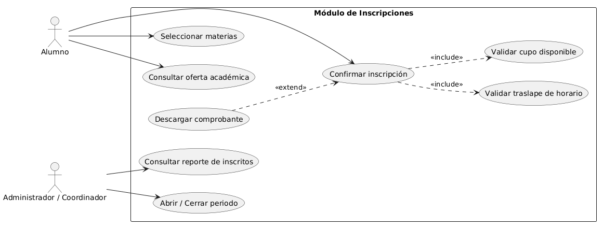

# Módulo 2: Inscripciones

## 1. Resumen
El Módulo de Inscripciones se encarga de gestionar el proceso de registro y asignación de materias para los alumnos dentro del sistema. Permite validar los requisitos de inscripción, gestionar cupos por grupo y generar los comprobantes o registros correspondientes.

## 2. Objetivo y Alcance
- **Objetivo General:** Automatizar el proceso de inscripción para garantizar un registro ágil y sin duplicidades de alumnos en las asignaturas.
- **Alcance:**
  - Consulta de oferta académica disponible.
  - Selección y validación de asignaturas/horarios.
  - Registro en base de datos y generación de comprobantes.

## 3. Información del Equipo
- **Equipo:** 2  
- **Módulo:** Inscripciones  
- **Integrantes:**
  - Pamela Concepción Abasolo Díaz
  - Héctor Jesús García Monroy
  - Kevin Alejandro Nabor Matias
  - Santiago Cuevas Sanchez

## 1. Actores
* *Alumno:* Consulta materias disponibles, arma su horario preliminar y solicita su inscripción formal.
* *Administrador / Coordinador:* Abre o cierra los periodos de inscripción, define cupos y valida/ajusta inscripciones cuando sea necesario.
* *Sistema (automatizado):* Valida que no existan traslapes de horario y actualiza los lugares disponibles.

## 2. Requerimientos Funcionales (RF)
* *Consultar oferta académica:* El sistema debe permitir visualizar las materias ofertadas, grupos, docentes asignados y cupos disponibles en tiempo real.
* *Selección de materias:* El sistema debe permitir al alumno agregar o quitar materias a una lista preliminar de inscripción.
* *Validación de choques de horario:* El sistema debe impedir que el alumno inscriba dos materias que compartan el mismo bloque de horario y día.
* *Validación de cupo máximo:* El sistema no debe permitir inscribir a un alumno en un grupo cuyo cupo se encuentre en 0.
* *Confirmar inscripción:* El sistema debe registrar la selección final del alumno, descontar los cupos correspondientes y generar un folio/comprobante de inscripción.
* *Gestión de periodos de inscripción:* El administrador debe poder activar y desactivar las fechas hábiles para que los alumnos puedan inscribirse.
* *Generación de horario/comprobante:* El sistema debe generar una vista resumen imprimible o descargable con el horario final del alumno inscrito.

## 5. Contenido
# Diagrama de casos de uso:
```
@startuml
left to right direction

actor "Alumno" as alumno
actor "Administrador / Coordinador" as admin

rectangle "Módulo de Inscripciones" {
usecase "Consultar oferta académica" as UC1
usecase "Seleccionar materias" as UC2
usecase "Confirmar inscripción" as UC3
usecase "Validar traslape de horario" as UC4
usecase "Validar cupo disponible" as UC5
usecase "Descargar comprobante" as UC6
usecase "Abrir / Cerrar periodo" as UC7
usecase "Consultar reporte de inscritos" as UC8
}

alumno --> UC1
alumno --> UC2
alumno --> UC3

UC3 ..> UC4 : <<include>>
UC3 ..> UC5 : <<include>>
UC6 ..> UC3 : <<extend>>


admin --> UC7
admin --> UC8

@enduml
```



## 7. Referencias
1. Documentación oficial del lenguaje / framework utilizado.
2. Manual de arquitectura de base de datos del proyecto final.

## 8. Abreviaciones
- **BD:** Base de Datos.
- **UI:** Interfaz de Usuario (*User Interface*).

## 9. Requerimientos No Funcionales (RNF)
* *Usabilidad:* La interfaz debe ser intuitiva, permitiendo completar el proceso de inscripción en no más de 4 pasos guiados.
* *Rendimiento:* El tiempo de respuesta del sistema para confirmar y guardar la inscripción no debe superar los 2 segundos.
* *Integridad de datos:* El sistema debe garantizar que dos alumnos no puedan ocupar el último cupo disponible al mismo tiempo (control de concurrencia básico).
* *Disponibilidad:* El módulo debe estar disponible de forma continua durante los periodos oficiales de inscripción establecidos por la coordinación.
* *Compatibilidad:* La interfaz debe ser accesible y funcional desde cualquier navegador web moderno (Chrome, Firefox, Edge).
