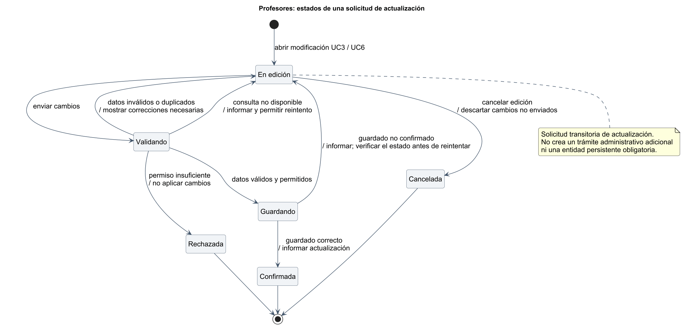

# Bloque B. Modificar datos y dar de baja profesores

**Estado:** propuesta para revisión del E3; no equivale a un PR enviado ni a reglas aprobadas. **Base oficial:** `553104011ece92aeeeecfe54298173bfb88e102f`.

## Contexto y casos de uso

La administración modifica un registro seleccionado o confirma su baja lógica. Modificar datos no reactiva un registro y darlo de baja no elimina su historial. La máquina de estados representa el ciclo transitorio de actualización en UC3 o UC6: edición, validación, guardado, confirmación, corrección, rechazo, cancelación, recuperación tras una consulta fallida y verificación del estado antes de reintentar un guardado no confirmado.

| ID | Caso de uso, secuencia y actividades | Actor |
|---|---|---|
| UC3 | [Modificar datos del profesor](uc3_modificar.md) | Administrador escolar |
| UC4 | [Dar de baja profesor](uc4_baja.md) | Administrador escolar |

Cada caso enlaza su fuente UML y su imagen, e indica condiciones, resultados y alternativas. Las secuencias separan actor, vista, control, acceso compartido y registro como responsabilidades lógicas propuestas; no fijan una tecnología ni prueban software implementado. Distinguen ausencia de registro de fallo de consulta; UC3 también representa el fallo al consultar duplicados antes de guardar.

## Estados de una solicitud de actualización

[Fuente UML](../resources/uml/m3_estados_actualizacion.uml)

## Acuerdos pendientes

Validar campos permitidos, criterios de duplicidad excluyendo el propio registro, reglas de acceso a registros dados de baja y el comportamiento de las referencias históricas. Coordinar con el bloque C que ambos casos de actualización usen el mismo ciclo. La solicitud es una representación transitoria, no un trámite administrativo ni una tabla persistente obligatoria. Cada reenvío debe repetir las validaciones y el control de acceso.

## Fuentes

- [Profesores en la base oficial](https://github.com/wichis/26b_is1_proyecto-final/blob/553104011ece92aeeeecfe54298173bfb88e102f/modulos/m3_profesores.md), con los seis casos UC1–UC6.
- Aviso «Completar diagramas» aportado por el usuario: avances antes de las 9:00 a. m. del 20 de noviembre de 2026, fecha confirmada en este chat.
- Modelos propios expresados en [PlantUML](https://plantuml.com/), con fuente e imagen. La aceptación académica y los acuerdos de E1/E3 siguen sujetos a revisión.
