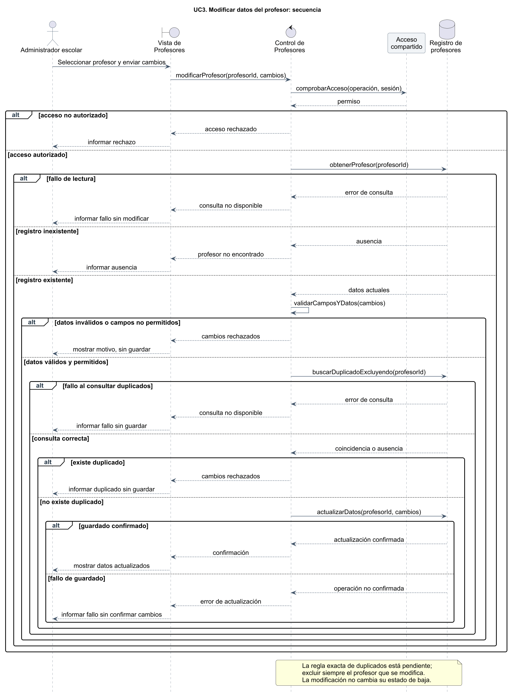
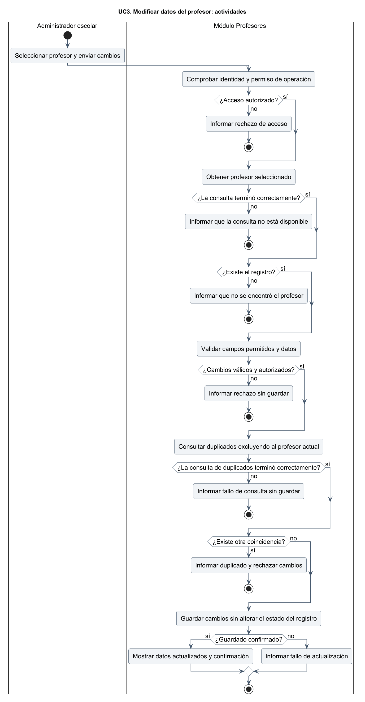

# UC3. Modificar datos del profesor

| Elemento | Definición del modelo propuesto |
|---|---|
| Actor | Administrador escolar. |
| Requisitos de origen | RF-04, RF-02 y RF-08 del módulo oficial. |
| Antes de comenzar | Sesión identificada, profesor seleccionado y permiso sobre la operación y los campos. |
| Resultado | Datos actualizados sin cambiar por sí mismos el estado de baja; o rechazo informado. |
| Alternativas representadas | Fallo de lectura; profesor inexistente; campos no permitidos; datos inválidos; fallo al consultar duplicados; duplicado y fallo al guardar. |

## Secuencia

El actor inicia la operación desde la vista del módulo. El control comprueba identidad y permiso con el acceso compartido. La secuencia separa el fallo de lectura de la ausencia del profesor y, antes de guardar, representa la validación de campos, la consulta de duplicados que excluye el registro actual y el fallo de esa consulta. Una modificación rechazada o no confirmada no se presenta como guardada. Las líneas de vida representan responsabilidades lógicas propuestas, no tecnologías o servicios ya implementados.

[Fuente UML](../resources/uml/m3_uc3_secuencia.uml)

## Actividades

El flujo separa la solicitud del actor y las acciones del módulo. Cada rombo formula una condición con salidas identificadas. Distingue error al consultar el registro de profesor inexistente, y error al consultar duplicados de una coincidencia real. Una operación fallida o rechazada termina sin mostrarse como confirmada.

[Fuente UML](../resources/uml/m3_uc3_actividades.uml)

## Acuerdos que afectan este caso

Los campos permitidos, formatos y criterios de duplicidad deben acordarse con los responsables de los datos. La consulta de duplicados debe excluir al profesor actual, pero los atributos concretos siguen pendientes. Las reglas para permitir modificaciones después de la baja requieren acuerdo; UC3 no reactiva un registro ni cambia su estado. Esta propuesta no fija longitudes, algoritmos de identificación, tiempos de respuesta ni tecnología de almacenamiento.

Las asignaciones a grupos, materias y horarios corresponden a los módulos relacionados; no se agregan a esta operación.

[Consultar el módulo oficial de referencia](https://github.com/wichis/26b_is1_proyecto-final/blob/553104011ece92aeeeecfe54298173bfb88e102f/modulos/m3_profesores.md).
