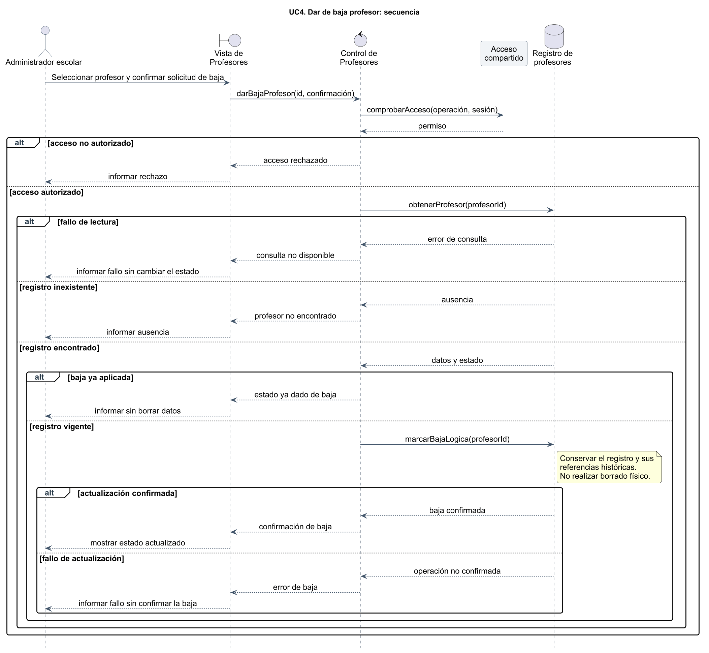
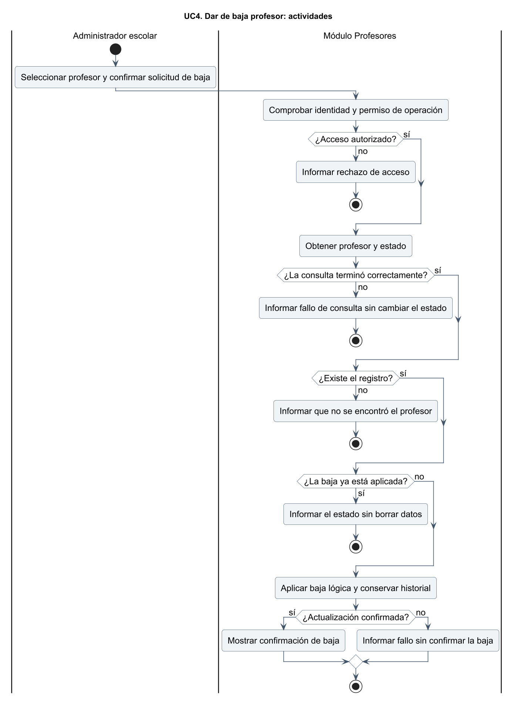

# UC4. Dar de baja profesor

| Elemento | Definición del modelo propuesto |
|---|---|
| Actor | Administrador escolar. |
| Requisitos de origen | RF-05, RF-08 y RNF-05 del módulo oficial. |
| Antes de comenzar | Sesión identificada, profesor seleccionado y confirmación de la solicitud de baja. |
| Resultado | Registro marcado con baja lógica e historial conservado; una repetición no borra datos. |
| Alternativas representadas | Permiso insuficiente; fallo de lectura; registro inexistente; baja ya aplicada y fallo al actualizar el estado. |

## Secuencia

El actor solicita y confirma la baja desde la vista del módulo. El control comprueba identidad y permiso antes de consultar el registro. La secuencia distingue fallo de lectura de registro inexistente y separa una baja ya aplicada de una baja nueva. La actualización es lógica: conserva el registro y sus referencias históricas, sin borrado físico. Las líneas de vida representan responsabilidades lógicas propuestas, no tecnologías o servicios ya implementados.

[Fuente UML](../resources/uml/m3_uc4_secuencia.uml)

## Actividades

El flujo separa la solicitud del actor y las acciones del módulo. Cada rombo formula una condición con salidas identificadas. Distingue fallo de consulta de registro inexistente; si la baja ya está aplicada, informa el estado sin borrar datos. Si falla la actualización, no muestra la baja como confirmada.

[Fuente UML](../resources/uml/m3_uc4_actividades.uml)

## Acuerdos que afectan este caso

La baja se representa como un cambio de estado y no elimina el registro ni el historial. El comportamiento de las asignaciones y referencias de otros módulos tras la baja requiere coordinación con sus responsables. Esta propuesta no define borrado físico, política de retención, longitudes, identificadores, tiempos de respuesta ni tecnología de almacenamiento.

Las asignaciones a grupos, materias y horarios corresponden a los módulos relacionados; no se agregan a esta operación.

[Consultar el módulo oficial de referencia](https://github.com/wichis/26b_is1_proyecto-final/blob/553104011ece92aeeeecfe54298173bfb88e102f/modulos/m3_profesores.md).
